# DevMeet v2.0 — Complete Codebase Architecture & System Overview

## 1. Executive Summary

**DevMeet v2.0** is an enterprise-ready, microservices-based AI interviewing and evaluation platform designed to simulate real-world technical hiring workflows. The system combines real-time Large Language Model (LLM) token streaming, client-side computer vision proctoring, sandboxed multi-language code execution in ephemeral Docker containers, audio transcription, automated 6-dimensional candidate evaluation with PDF report generation, and payment integration.

---

## 2. Global Architecture Diagram

```mermaid
flowchart TD
    Client["Candidate / Admin Browser\n(Next.js 14 / TypeScript)"]

    subgraph Edge ["Edge & Reverse Proxy Layer"]
        Gateway["Nginx API Gateway (:80 / :8000)\n• Rate Limiting\n• CORS Management\n• Dynamic Upstream Routing"]
    end

    subgraph CoreServices ["Core Domain Microservices (FastAPI / Node.js)"]
        AuthSvc["auth-service (:8001)\n• JWT & Session Management\n• RBAC & Admin Verification\n• MFA / TOTP & GeoIP Risk"]
        UserSvc["user-service (:8002)\n• Profiles & GDPR Export\n• Quota Enforcement\n• Leaderboard"]
        OrchSvc["orchestrator-service (:8003)\n• Session Lifecycle State Machine\n• Turn Orchestration\n• Heartbeat & Proctoring Telemetry"]
        AISvc["ai-interviewer-service (:8004)\n• Groq SSE Token Streaming\n• Multi-Key Rotation & Circuit Breaker\n• STAR Extraction & Adaptive Difficulty"]
        ExecSvc["code-execution-service (:8005)\n• Docker-based Sandboxing\n• Multi-language Test Runner\n• RabbitMQ Async Worker"]
        VideoSvc["video-service (:8006)\n• LiveKit WebRTC Access Tokens\n• Room Lifecycle & Inactivity Pruning"]
        FeedbackSvc["feedback-service (:8007)\n• 6D Evaluation Matrix\n• PDF Generation (WeasyPrint)\n• S3 Storage Integration"]
        AnalyticsSvc["analytics-service (:8009)\n• Funnel & Retention Analysis\n• Score Distribution & Trends\n• CSV Data Export"]
        AdminSvc["admin-service (:8010)\n• Cross-Service Health Matrix\n• User Ban / Impersonation\n• Audit Log Exploration"]
        FileSvc["file-service (:8011)\n• S3 Presigned URLs\n• Avatar & Resume Artifact Storage"]
        PaymentSvc["payment-service (:8012)\n• Razorpay Checkout & Webhooks\n• HMAC-SHA256 Verification\n• Subscription Management"]
        SearchSvc["search-service (:8013)\n• In-Memory Question Bank Search\n• Multi-tag Filtering & Randomizer"]
    end

    subgraph DataPlane ["Persistence & Messaging Plane"]
        Postgres[("PostgreSQL 16\nAuthoritative Schema")]
        RedisCache[("Redis 7.2\nCache, Locks, Quotas")]
        RabbitBus[("RabbitMQ 3.12\nOutbox & Async Jobs")]
        S3Storage[("AWS S3\nReports, Snapshots, Files")]
        GroqCloud["Groq Cloud LLM\n(LLaMA 3.3 70B / Mixtral)"]
        LiveKitCloud["LiveKit WebRTC Cloud"]
    end

    Client -->|HTTP / SSE / WS| Gateway
    Gateway -->|/api/v1/auth| AuthSvc
    Gateway -->|/api/v1/users| UserSvc
    Gateway -->|/api/v1/sessions| OrchSvc
    Gateway -->|/api/v1/interview| AISvc
    Gateway -->|/api/v1/execute| ExecSvc
    Gateway -->|/api/v1/video| VideoSvc
    Gateway -->|/api/v1/feedback| FeedbackSvc
    Gateway -->|/api/v1/analytics| AnalyticsSvc
    Gateway -->|/api/v1/admin| AdminSvc
    Gateway -->|/api/v1/files| FileSvc
    Gateway -->|/api/v1/payments| PaymentSvc
    Gateway -->|/api/v1/search| SearchSvc

    Client -.->|WebSocket Notifications| NotifSvc

    OrchSvc -->|Verify User| AuthSvc
    OrchSvc -->|Check / Increment Quota| UserSvc
    OrchSvc -->|Fetch First Question| SearchSvc
    OrchSvc -->|Trigger Async Evaluation| FeedbackSvc
    OrchSvc -->|Publish Events| RabbitBus

    AISvc -->|LLM Inference| GroqCloud
    ExecSvc -->|Consume Jobs| RabbitBus
    FeedbackSvc -->|Upload PDF| S3Storage
    VideoSvc -->|Tokens| LiveKitCloud

    AuthSvc & UserSvc & OrchSvc & FeedbackSvc & AnalyticsSvc & AdminSvc & PaymentSvc --> Postgres
    AuthSvc & UserSvc & OrchSvc & AISvc & ExecSvc & AnalyticsSvc & AdminSvc --> RedisCache
```

---

## 3. Technology Stack & Protocol Catalog

| Component | Technology | Role & Purpose | Communication Protocol |
|---|---|---|---|
| **Frontend** | Next.js 14, React 18, TypeScript, Tailwind CSS, Zustand, Monaco Editor | Client-side interface, in-browser proctoring (MediaPipe + TensorFlow.js), code editor, Web Speech API | HTTPS, SSE, WSS |
| **API Gateway** | Nginx (Alpine) | Reverse proxy, dynamic CORS origin reflection, token validation subrequest, rate limiting | HTTP/1.1, HTTP/2 |
| **Microservices Backend** | Python 3.11/3.13 (FastAPI, Uvicorn, AsyncPG, Pydantic) | 11 backend microservices handling domain capabilities | Asynchronous REST, SSE |
| **Realtime Video / Notification Services** | Node.js 20, Express, `ws`, `livekit-server-sdk`, `@aws-sdk/client-ses` | WebRTC token generator, WebSocket notification broadcaster | HTTP, WSS |
| **Authoritative Database** | PostgreSQL 16 | Relational persistence, transactional integrity, foreign key cascades, JSONB fields, GIN indexes | PostgreSQL Wire Protocol (TCP 5432) |
| **Distributed Cache & State** | Redis 7.2 | Distributed locks, active session tracking, rate-limiting windows, token blacklisting, job results | RESP (TCP 6379) |
| **Message Broker** | RabbitMQ 3.12 | Transactional outbox event bus, asynchronous code execution task queues | AMQP 0-9-1 (TCP 5672) |
| **Sandboxing Engine** | Docker Engine API / Ephemeral Containers | Secure multi-language compilation and execution with `--network none`, CPU, and memory limits | Docker Socket (`/var/run/docker.sock`) |
| **LLM Provider** | Groq Cloud API | Ultra-low latency LLaMA 3.3 70B & Mixtral inference for SSE token streaming and candidate scoring | HTTPS REST / SSE |
| **Object Storage** | AWS S3 / MinIO | Encrypted storage for generated evaluation PDFs, interview audio/snapshots, user avatars | S3 API / SigV4 |

---

## 4. Complete Request Lifecycles

### 4.1 Interview Creation & Turn Lifecycle
1. **User Authentication**: Client sends `POST /api/v1/auth/login`. `auth-service` validates credentials with bcrypt, logs login history with GeoIP, and returns a signed HS256 JWT access token and refresh token.
2. **Session Creation**: Client calls `POST /api/v1/sessions` through Nginx.
   - Nginx forwards to `orchestrator-service`.
   - `orchestrator-service` validates JWT against `auth-service`.
   - Concurrently checks user quota via `user-service` and confirms no active session exists via Redis key `user:{user_id}:active_session`.
   - Fetches a domain-matched seed question from `search-service`.
   - Inserts new row into `sessions` table in status `created`.
   - Acquires active session lock in Redis.
3. **Turn Execution (Live Dialogue)**:
   - Client sends speech audio or typed text to `POST /api/v1/sessions/{id}/turns`.
   - Orchestrator validates session status (`in_progress`).
   - Inserts candidate turn into `conversation_turns`.
   - Queries `ai-interviewer-service` (`POST /api/v1/interview/question/stream`).
   - `ai-interviewer-service` runs prompt injection filters, loads context window, selects available Groq API key from rotation pool, executes circuit-breaker protected call to Groq, and streams response tokens back over SSE.
   - Orchestrator records AI interviewer response into `conversation_turns`.

### 4.2 Sandboxed Code Execution Lifecycle
1. Candidate writes code in Python, JavaScript, C++, Java, Go, or Rust in Monaco Editor.
2. Candidate clicks "Run Code":
   - **Synchronous**: Frontend calls `POST /api/v1/execute`. `code-execution-service` runs safety heuristic checks (AST/regex for dangerous syscalls like `fork`, `subprocess`, file modifications), writes code to ephemeral temp directory, spawns isolated Docker container with memory limit (`128m`), CPU quota (`0.5`), read-only root, and no network access (`--network none`), passes input via stdin, captures stdout/stderr, and terminates container within timeout.
   - **Asynchronous / Test Runner**: Client calls `POST /api/v1/execute/run-tests` with visible and hidden test cases. Service runs each test case, calculates pass/fail matrix and runtime metrics, and returns structured result.

### 4.3 Session Completion & 6D Feedback Generation
1. Interview timer expires or candidate completes all questions:
   - Frontend calls `POST /api/v1/sessions/{id}/complete`.
   - Orchestrator marks session `completed`, releases Redis active session lock, increments monthly user quota via `user-service`, writes a `session.completed` event to `outbox_events` table (Transactional Outbox Pattern), and asynchronously calls `feedback-service`.
2. `feedback-service` processes evaluation:
   - Fetches complete conversation turns transcript.
   - Submits transcript to Groq LLM with 6D evaluation rubric:
     1. Problem Solving (0-100)
     2. Code Quality (0-100)
     3. System Architecture (0-100)
     4. STAR Behavioral Framework (0-100)
     5. Communication (0-100)
     6. Edge Case Handling (0-100)
   - Calculates percentile comparison against difficulty and peer distribution.
   - Generates responsive HTML report and compiles to PDF using WeasyPrint.
   - Uploads PDF to AWS S3 bucket and persists report metadata to `feedback_reports` table.

---

## 5. Microservices Directory & Responsibilities

| Service | Port | Entry Point | Core Responsibilities |
|---|:---:|---|---|
| `api-gateway` | 80 / 8000 | `nginx.conf` | Central ingress, rate-limiting, CORS, security headers, internal auth subrequests |
| `auth-service` | 8001 | `app/main.py` | JWT token issuing, bcrypt password hashing, MFA/TOTP, GeoIP login tracking, token blacklisting |
| `user-service` | 8002 | `app/main.py` | User profiles, subscription tier quotas (free vs pro), GDPR data export, avatar handling |
| `orchestrator-service` | 8003 | `app/main.py` | Central interview state machine, turn management, outbox publisher, cheating telemetry |
| `ai-interviewer-service` | 8004 | `app/main.py` | Groq LLaMA 3.3 SSE token streaming, multi-key rotation, circuit breaker, STAR extraction, prompt injection defense |
| `code-execution-service` | 8005 | `app/main.py` | Ephemeral Docker sandbox execution, multi-language test runner, AST safety scanning, async task queue |
| `video-service` | 8006 | `src/index.js` | LiveKit WebRTC JWT token generation, room lifecycle management, inactivity auto-closure |
| `feedback-service` | 8007 | `app/main.py` | 6D scoring evaluation matrix, HTML report generation, WeasyPrint PDF compilation, S3 upload |
| `analytics-service` | 8009 | `app/main.py` | User score trends, category performance metrics, retention funnels, CSV exports |
| `admin-service` | 8010 | `app/main.py` | Cross-service health probes, user account blocking/unblocking, impersonation tokens, audit log querying |
| `file-service` | 8011 | `app/main.py` | AWS S3 object upload/download, presigned URL generation, local disk fallback |
| `payment-service` | 8012 | `app/main.py` | Razorpay order creation, payment verification via HMAC-SHA256, mock sandbox checkout, billing history |
| `search-service` | 8013 | `app/main.py` | Question bank search (2,000+ curated questions), token filtering by type, difficulty, and company tags |

---

## 6. Authoritative Database Schema Design

All tables reside in PostgreSQL database `devmeet` under public schema:

- **Identity & Accounts**:
  - `user_profiles`: User accounts, emails, hashed passwords, MFA secrets, OAuth IDs, block status.
  - `user_plans`: Current active plan (`free`, `pro`, `enterprise`).
  - `usage_quotas`: Monthly and daily interview counts with automatic date-based reset.
  - `login_attempts` & `login_history`: Security auditing and brute-force lockout tracking.
- **Interviews & State**:
  - `sessions`: Interview session aggregate, status enum (`created`, `in_progress`, `paused`, `completed`, `cancelled`), telemetry counters (tab switches, paste count).
  - `conversation_turns`: Ordered interview dialogue turns between AI interviewer and candidate.
  - `code_submissions`: Code drafts and test submissions linked to sessions.
- **Evaluation & Billing**:
  - `feedback_reports`: 6D score breakdown, detailed qualitative feedback JSONB, S3 PDF URL.
  - `subscriptions` & `billing_events`: Active payment provider subscriptions and audit trail of transactions.
- **Reliability & Enterprise Patterns**:
  - `idempotency_records`: Guarantees HTTP POST idempotency with 24-hour expiration.
  - `outbox_events`: Transactional Outbox table ensuring atomic database updates and eventual message delivery to RabbitMQ.
  - `audit_logs`: Immutable security audit log tracking administrative and user lifecycle actions.

---

## 7. Deep-Dive Companion Documents

For comprehensive endpoint-by-endpoint tracing, dependency topologies, and technical interview preparation, consult the companion architectural guides:
- [API Integration Audit](API_INTEGRATION_AUDIT.md) — Complete route matrix mapping every API from React frontend components down to SQL repositories.
- [Microservice Dependency & Topology Map](MICROSERVICE_DEPENDENCY_MAP.md) — Architectural topologies, sequence flows for all major user journeys, and inter-service communication contracts.
- [Technical Interview Preparation Guide](INTERVIEW_GUIDE.md) — 50+ real-world interview Q&As covering distributed transactions, SSE vs WebSockets, circuit breakers, sandboxing, and database design.
- [Refactoring Changelog](REFACTORING_CHANGELOG.md) — Historical log of modularizations, bug fixes, and safety improvements.

