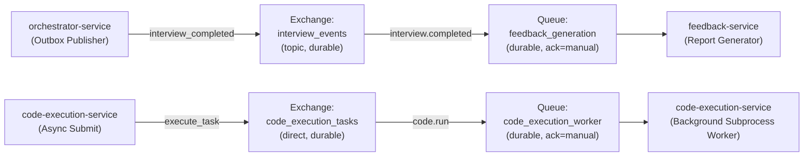

# DevMeet v2.0 — Data Stores, Redis Caching & Background Jobs Audit

This document presents a comprehensive audit of all persistence layers, caching strategies, message queues, transaction patterns, and background workers operating across DevMeet v2.0.

---

## 1. Relational Database Audit (PostgreSQL 16)

### 1.1. Authoritative Schema & Migration Topology
The database schema is initialized via `migrations/init_dev_schema.sql` (14.7 KB) on PostgreSQL 16 under the `devmeet` database name.

All 16 verified tables residing in the `public` schema:

| Table Name | Owning Service | Primary Key | Foreign Keys & Relationships | Purpose |
| :--- | :--- | :--- | :--- | :--- |
| `user_profiles` | `auth-service` / `user-service` | `id` (UUID) | None | Core user account: email, hashed password, role, display name, MFA secret, status. |
| `user_plans` | `user-service` / `payment-service` | `id` (UUID) | `user_id` -> `user_profiles(id)` | Current tier (`free`, `pro`, `enterprise`), validity period, and renewal timestamps. |
| `usage_quotas` | `user-service` | `id` (UUID) | `user_id` -> `user_profiles(id)` | Monthly interview limits, completed sessions count, and automatic date-based reset. |
| `login_attempts` | `auth-service` | `id` (UUID) | None | Tracks IP and email failed login attempts to trigger 10-minute brute-force lockout. |
| `login_history` | `auth-service` | `id` (UUID) | `user_id` -> `user_profiles(id)` | Security audit log recording IP address, User-Agent, timestamp, and geo-location. |
| `password_resets` | `auth-service` | `id` (UUID) | `user_id` -> `user_profiles(id)` | Cryptographic reset tokens with 15-minute expiration and single-use invalidation. |
| `sessions` | `orchestrator-service` | `id` (UUID) | `user_id` -> `user_profiles(id)` | Core interview entity: status enum, question ID, difficulty, elapsed time, cheating counters. |
| `conversation_turns` | `orchestrator-service` | `id` (UUID) | `session_id` -> `sessions(id)` | Ordered turn-by-turn dialogue between candidate and AI interviewer. |
| `code_submissions` | `code-execution-service` | `id` (UUID) | `session_id` -> `sessions(id)` | Candidate code drafts, final submissions, language, pass/fail counts, snapshot URLs. |
| `feedback_reports` | `feedback-service` | `id` (UUID) | `session_id` -> `sessions(id)` | 6D performance scores (0-100), detailed qualitative analysis JSONB, S3 PDF URL. |
| `analytics_events` | `analytics-service` | `id` (UUID) | `user_id` (optional), `session_id` | Fine-grained telemetry events (feature clicks, timing, tab-switches). |
| `audit_logs` | `admin-service` | `id` (UUID) | `admin_id` -> `user_profiles(id)` | Immutable security trail of all administrative interventions (bans, plan changes). |
| `subscriptions` | `payment-service` | `id` (UUID) | `user_id` -> `user_profiles(id)` | Active Razorpay subscription IDs, status, billing cycle start/end dates. |
| `billing_events` | `payment-service` | `id` (UUID) | `user_id` -> `user_profiles(id)` | Financial ledger: Razorpay order IDs, payment IDs, invoice amounts, status. |
| `idempotency_records`| Shared / Ingress | `idempotency_key` (VARCHAR) | None | Guarantees POST idempotency across network retries with 24-hour expiration. |
| `outbox_events` | `orchestrator-service` | `id` (UUID) | None | Implements the Transactional Outbox pattern for reliable async messaging. |

### 1.2. Database Connection Pooling & Lifecycle
- Every Python FastAPI service utilizes `asyncpg` connection pooling:
  - Default pool settings: `min_size=5`, `max_size=20`, `max_inactive_connection_lifetime=300.0`.
  - Application startup hooks (`@app.on_event("startup")` or FastAPI `lifespan`) initialize the pool.
  - Shutdown hooks invoke `await pool.close()` ensuring zero dangling TCP connections.
- Parameterized SQL statements are used universally (`SELECT ... WHERE id = $1`), eliminating SQL injection vulnerabilities.

---

## 2. In-Memory Caching & State Store (Redis 7.2)

### 2.1. Key Namespaces & TTL Policies

| Key Pattern | Owning Service | Type | Default TTL | Purpose |
| :--- | :--- | :---: | :---: | :--- |
| `token_blacklist:{jti}` | `auth-service` | String | Token lifetime | Revokes JWT tokens immediately upon candidate logout. |
| `email_verify:{user_id}` | `auth-service` | String | 86,400s (24h) | Stores 6-digit registration verification OTP. |
| `reset_token:{token}` | `auth-service` | String | 900s (15m) | Temporary password recovery token. |
| `mfa_token:{token}` | `auth-service` | String | 300s (5m) | Short-lived challenge token issued before TOTP verification. |
| `quota:{user_id}` | `user-service` | Hash | 3,600s (1h) | Fast in-memory cache of candidate interview usage quotas. |
| `session:heartbeat:{id}` | `orchestrator-service` | String | 90s | Liveness tracking. Sessions auto-pause if heartbeats cease. |
| `job_status:{job_id}` | `code-execution-service`| Hash | 3,600s (1h) | Asynchronous test execution job status and results. |
| `ai:rate:{user_id}` | `ai-interviewer-service` | String | 60s | Token bucket rate limiter preventing prompt flooding. |
| `leaderboard:global` | `user-service` | Sorted Set | 600s (10m) | Top candidate rankings scored by evaluation percentiles. |

### 2.2. Failure & Recovery
- Redis operates with standard AOF (Append-Only File) persistence in `docker-compose.yml` mapped to the `redis_data` volume.
- If Redis restarts, all blacklisted tokens and temporary challenge states are recovered from disk.

---

## 3. Asynchronous Messaging & Background Workers (RabbitMQ 3.12)

### 3.1. Topology, Exchanges & Queues

### 3.2. Transactional Outbox Pattern
To prevent distributed transaction failures (dual-write problem where the database updates but message publishing fails):
1. `orchestrator-service` wraps both the session status update and an `INSERT INTO outbox_events (aggregate_type, payload, status)` inside a single atomic PostgreSQL transaction.
2. An asynchronous background task polls `outbox_events WHERE status = 'pending' ORDER BY created_at ASC LIMIT 50`.
3. The worker publishes the event to RabbitMQ.
4. Upon receiving publishing acknowledgment from the RabbitMQ broker, the worker updates the outbox record to `status = 'published'`.
5. If the broker is temporarily unreachable, events remain securely staged in PostgreSQL and are automatically retried upon reconnection.

### 3.3. Job Idempotency
- Consuming workers extract the unique event ID and query `idempotency_records`.
- If an event ID already exists with status `PROCESSED`, the worker immediately acknowledges the message without duplicating evaluation or code execution jobs.
