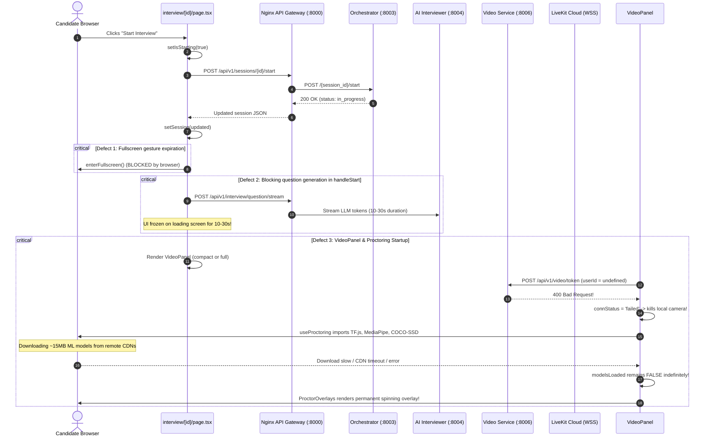

# DevMeet v2.0 — Interview Startup Root Cause Analysis & Audit

## Executive Summary

During the comprehensive audit of the interview startup workflow, we identified why candidates clicking **"Start Interview"** experienced indefinite loading spinners or error screens. The failure is not a single bug, but a cascade of 5 interrelated defects across client-side proctoring ML initialization, asynchronous state management in the interview page, and LiveKit WebRTC identity handling.

---

## 1. Trace of the Interview-Start Flow

---

## 2. Root Causes Identified

### Root Cause 1: Permanent Opaque Loading Overlay in `ProctorOverlays.tsx` & Unbounded CDN Downloads in `useProctoring.ts`
- **File**: `frontend/src/app/interview/video/ProctorOverlays.tsx` (Lines 73–87) & `frontend/src/app/interview/hooks/useProctoring.ts` (Lines 45–98)
- **Symptom**: The candidate's camera preview is completely covered by an opaque dark backdrop (`bg-slate-950/80`) displaying a spinning icon and `Initializing Proctor AI...`.
- **Root Cause**:
  1. `useProctoring.ts` dynamically imports `@tensorflow/tfjs`, `@tensorflow-models/coco-ssd`, and `@mediapipe/tasks-vision`, then downloads 3 large model files from external Google and jsDelivr CDNs.
  2. There is **no timeout** on this download.
  3. If any promise rejects or is blocked by network latency, ad-blockers, or CSP, the `catch` block sets `proctorError`, but `modelsLoaded` remains `false`.
  4. `ProctorOverlays.tsx` checks `{!modelsLoaded && <Overlay>}` without checking for error or timeout.
  5. The spinning overlay **never unmounts**, leaving the interview proctor screen in an infinite loading state.

### Root Cause 2: Blocking LLM Question Generation Awaited Inside `handleStart`
- **File**: `frontend/src/app/interview/[id]/page.tsx` (Lines 231–252)
- **Symptom**: Clicking "Start Interview" freezes the application on the loading screen for up to 30 seconds, or displays an unrecoverable error if token streaming encounters a rate-limit or timeout.
- **Root Cause**:
  1. `handleStart` awaited `await streaming.generateQuestion([], updated)` before executing `finally { setIsStarting(false) }`.
  2. Because SSE question generation takes 5–25 seconds to complete, `isStarting` remained `true` throughout the entire streaming lifecycle.
  3. If question generation failed, `catch (err)` set `chatError`, but the backend session was already in `in_progress` status. When `isStarting` finally reset to `false`, the interview screen loaded with an empty chat, missing the initial question, and displaying a start failure message.

### Root Cause 3: Undefined `userId` Causing HTTP 400 on LiveKit Token Generation
- **File**: `frontend/src/app/interview/hooks/useWebRTC.ts` (Lines 30–50) & `frontend/src/app/interview/VideoPanel.tsx` (Line 74)
- **Symptom**: Video connection fails after 3 retries, camera track is killed, and logs report `Failed to generate access token`.
- **Root Cause**:
  1. In `page.tsx`, `userId` was passed as `user?.id`. If the candidate navigated to the interview before `AuthContext` hydrated `/api/v1/auth/me`, `userId` was `undefined`.
  2. `videoApi.getToken` sent `{"participant_identity": undefined}`.
  3. `services/video-service/src/index.js` strictly requires `participant_identity`, responding with `400 Bad Request`.
  4. In `VideoPanel.tsx`, line 94 executed: `if (rtc.connStatus === 'failed') media.setUseAudioOnly(true);`.
  5. This killed the local camera stream (`stream.getVideoTracks().forEach(t => t.stop())`), turning off the camera preview entirely.

### Root Cause 4: Fullscreen Browser Security Gesture Expiration
- **File**: `frontend/src/app/interview/[id]/page.tsx` (Line 239)
- **Symptom**: Fullscreen request denied in Chrome/Firefox/Edge.
- **Root Cause**:
  1. Browsers require `element.requestFullscreen()` to be triggered synchronously within a direct user interaction event.
  2. `handleStart` placed `enterFullscreen()` after `await sessionApi.start(session.id)`. By the time the HTTP round-trip resolved, the user activation token expired.

### Root Cause 5: Lack of an Explicit Lifecycle State Machine
- **File**: `frontend/src/app/interview/[id]/page.tsx`
- **Symptom**: Race conditions, duplicate start clicks, and desynchronized UI flags.
- **Root Cause**:
  The interview page previously juggled independent boolean flags (`pageLoading`, `isStarting`, `isEnding`, `isCancelling`, `deviceCheckDone`, `modelsLoaded`, `connStatus`). Any desynchronization led to stuck states or impossible UI combinations.

---

## 3. Actionable Remediation Plan

1. **Self-Healing Proctoring Model Loader**:
   - Add a 4.5-second timeout to `useProctoring.ts`. If ML models fail or time out, fall back gracefully to standard video proctoring without blocking the camera view.
   - Update `ProctorOverlays.tsx` so the loading spinner automatically dissolves upon timeout or error, displaying a subtle non-blocking status pill.
2. **Non-Blocking Studio Initialization**:
   - Decouple question generation from `handleStart`. Once `sessionApi.start` completes, immediately transition into the active interview studio.
   - Stream the first question inside the studio with an active typing indicator, allowing the candidate to see the interviewer actively preparing.
3. **Guaranteed Identity Fallbacks for LiveKit**:
   - Provide a guaranteed fallback identifier: `user?.id || session?.user_id || 'candidate_' + sessionId.slice(0, 8)`.
   - Prevent WebRTC connection failures from killing the local camera feed.
4. **Typed Lifecycle State Machine**:
   - Implement explicit lifecycle states: `PREPARING` → `DEVICE_CHECK` → `READY_TO_START` → `LAUNCHING` → `ACTIVE` → `PAUSED` → `ENDING` → `ERROR`.
   - Enforce idempotent state transitions and provide explicit retry mechanisms.
