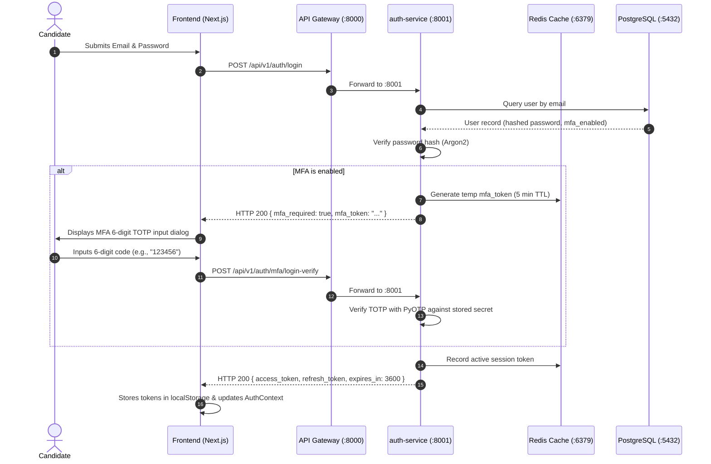
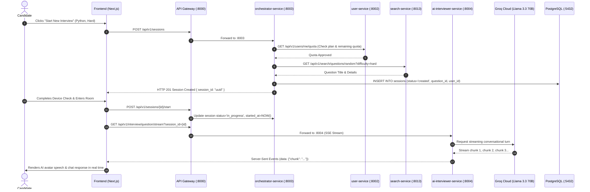
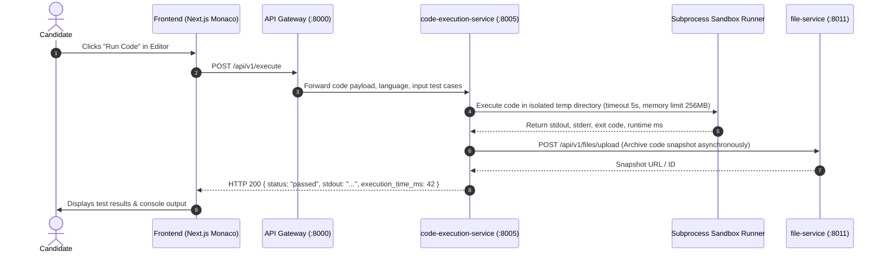
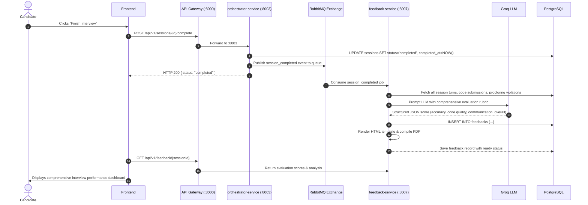

# DevMeet v2.0 — Microservice Dependency & Topology Map

This document details the architectural topology, service-to-service communication paths, messaging queues, persistent storage systems, and external third-party API dependencies for the entire DevMeet platform.

---

## 1. System Topology Overview

```mermaid
flowchart TD
    subgraph Client ["Client Layer"]
        Browser["Next.js 14 Frontend (:3000)\n(App Router, Tailwind, Monaco Editor, Lucide)"]
    end

    subgraph Edge ["Edge / Ingress"]
        Nginx["API Gateway (:8000)\n(Nginx Reverse Proxy, CORS, SSL, Buffering)"]
    end

    subgraph Services ["Backend Microservices"]
        Auth["auth-service (:8001)\nFastAPI / PyOTP / JWT"]
        User["user-service (:8002)\nFastAPI / Quota / Profiles"]
        Orch["orchestrator-service (:8003)\nFastAPI / Session State Machine"]
        AI["ai-interviewer-service (:8004)\nFastAPI / SSE Streaming / Whisper"]
        Exec["code-execution-service (:8005)\nFastAPI / Sandboxed Execution"]
        Video["video-service (:8006)\nNode.js Express / WebRTC Rooms"]
        Feedback["feedback-service (:8007)\nFastAPI / Report Generation / PDF"]
        Analytics["analytics-service (:8009)\nFastAPI / Events & KPI Aggregation"]
        Admin["admin-service (:8010)\nFastAPI / Management & Audit Logs"]
        File["file-service (:8011)\nFastAPI / S3 & Local Disk Fallback"]
        Payment["payment-service (:8012)\nFastAPI / Razorpay Integration"]
        Search["search-service (:8013)\nFastAPI / Full-text Search"]
    end

    subgraph Data ["Data & Messaging Layer"]
        PG[("PostgreSQL 16 (:5432)\nDatabase: devmeet")]
        Redis[("Redis 7.2 (:6379)\nSessions, Quotas, Blacklist, Cache")]
        RMQ["RabbitMQ 3.12 (:5672)\nAsync Job Queues"]
    end

    subgraph External ["External Third-Party APIs"]
        Groq["Groq Cloud API\n(Llama 3.3 70B & Whisper Large v3)"]
        LiveKit["LiveKit Cloud\n(WebRTC Video SFU)"]
        Razorpay["Razorpay API\n(Order IDs & Signature Verification)"]
        AWS["AWS S3 / SES\n(Object Storage & Optional Mail)"]
    end

    %% Client to Gateway
    Browser -->|HTTP / SSE / WebSocket| Nginx

    %% Gateway to Microservices
    Nginx -->|/api/v1/auth| Auth
    Nginx -->|/api/v1/users| User
    Nginx -->|/api/v1/sessions| Orch
    Nginx -->|/api/v1/interview| AI
    Nginx -->|/api/v1/execute| Exec
    Nginx -->|/api/v1/video| Video
    Nginx -->|/api/v1/feedback| Feedback
    Nginx -->|/api/v1/analytics| Analytics
    Nginx -->|/api/v1/admin| Admin
    Nginx -->|/api/v1/files| File
    Nginx -->|/api/v1/payments| Payment
    Nginx -->|/api/v1/search| Search

    %% Inter-service HTTP
    Orch -->|Quota Check| User
    Orch -->|Random Question| Search
    Orch -->|Run Test Cases| Exec
    User -->|Avatar Upload| File
    Exec -->|Save Code Snapshot| File
    Feedback -->|Save Report PDF| File

    %% External Connections
    AI -->|LLM Prompts & Whisper Audio| Groq
    Feedback -->|LLM Evaluation Prompt| Groq
    Video -->|Tokens & Rooms| LiveKit
    Payment -->|Checkout & Verify| Razorpay
    File -->|Object Blobs| AWS

    %% Data Connections
    Auth --> PG
    Auth --> Redis
    User --> PG
    User --> Redis
    Orch --> PG
    Orch --> Redis
    Orch --> RMQ
    Exec --> RMQ
    Exec --> Redis
    Feedback --> PG
    Feedback --> RMQ
    Analytics --> PG
    Analytics --> Redis
    Admin --> PG
    Payment --> PG
    Search --> PG
```

---

## 2. Microservice Ports & Technology Stack Matrix

| Service Name | Port | Primary Tech Stack | Primary Database / State Store | External Integrations | Primary Purpose |
| :--- | :--- | :--- | :--- | :--- | :--- |
| **`api-gateway`** | 8000 | Nginx Alpine | N/A | None | Reverse proxy, path routing, CORS header management, client connection buffering. |
| **`auth-service`** | 8001 | FastAPI / Python 3.11 | PostgreSQL (`users`), Redis (tokens) | Argon2 / PyOTP | JWT access & refresh token issuance, user registration, 2FA MFA enrollment, login validation. |
| **`user-service`** | 8002 | FastAPI / Python 3.11 | PostgreSQL (`users`), Redis (quotas) | `auth-service`, `file-service` | User profile updates, interview quota counters, tier plans, user data export (GDPR). |
| **`orchestrator-service`** | 8003 | FastAPI / Python 3.11 | PostgreSQL (`sessions`, `turns`), Redis | `user-service`, `search-service`, `code-execution-service` | Central state machine for interviews: starts, pauses, resumes, turns, and anti-cheating tracking. |
| **`ai-interviewer-service`** | 8004 | FastAPI / Python 3.11 | In-Memory Token Bucket & Circuit Breaker | Groq Cloud (`llama-3.3-70b`, `whisper-large-v3`) | Server-Sent Events (SSE) AI interviewer response streaming, candidate audio transcription, hints. |
| **`code-execution-service`** | 8005 | FastAPI / Python 3.11 | Redis (job cache), RabbitMQ (async jobs) | Subprocess Sandbox, `file-service` | Secure code execution (Python, JS, TS, Java, C++, Go) with memory/timeout constraints. |
| **`video-service`** | 8006 | Express / Node.js 20 | In-Memory Room Map (`roomManager.js`) | LiveKit Cloud / In-Memory fallback | WebRTC access tokens, device preflight audio/video checks, network quality monitoring. |
| **`feedback-service`** | 8007 | FastAPI / Python 3.11 | PostgreSQL (`feedbacks`), RabbitMQ | Groq LLM, AWS S3 / `file-service`, Weasyprint | Automated rubric evaluation (syntax, complexity, soft skills) and PDF report generation. |
| **`analytics-service`** | 8009 | FastAPI / Python 3.11 | PostgreSQL (`analytics_events`), Redis | None | Real-time event ingestion, dashboard metrics, score trend calculations. |
| **`admin-service`** | 8010 | FastAPI / Python 3.11 | PostgreSQL (`users`, `audit_logs`), Redis | None | System-wide statistics, user suspension/reactivation, role elevation, impersonation tokens. |
| **`file-service`** | 8011 | FastAPI / Python 3.11 | Local Disk (`uploads/`) & AWS S3 | AWS S3 SDK (boto3) | Presigned download URLs, multi-part upload handling, code snapshot & avatar file persistence. |
| **`payment-service`** | 8012 | FastAPI / Python 3.11 | PostgreSQL (`subscriptions`, `payments`) | Razorpay API | Subscription billing, checkout sessions, HMAC-SHA256 signature verification, webhook processing. |
| **`search-service`** | 8013 | FastAPI / Python 3.11 | PostgreSQL (`questions`) | None | Filtered question bank queries (by company, topic, difficulty) and random interview prompt selection. |

---

## 3. Core End-to-End User Journeys

### 3.1. Authentication & MFA Verification Flow

---

### 3.2. Technical Interview Session & Live AI Streaming

---

### 3.3. Code Execution & Sandboxing Flow

---

### 3.4. Session Completion, AI Evaluation & PDF Generation

---

## 4. Synchronous vs Asynchronous Communication Matrix

| Source Service | Target / Queue | Protocol | Communication Type | Payload / Purpose | Failure Handling |
| :--- | :--- | :--- | :--- | :--- | :--- |
| **`orchestrator-service`** | `user-service` | HTTP/REST | Synchronous | Quota verification (`GET /me/quota`) | Rejects session creation if quota exceeded or service times out. |
| **`orchestrator-service`** | `search-service` | HTTP/REST | Synchronous | Random question query (`GET /random`) | Fallback to default in-memory seed questions. |
| **`orchestrator-service`** | `code-execution-service` | HTTP/REST | Synchronous | Direct test runner (`POST /execute`) | Returns error output to candidate console. |
| **`orchestrator-service`** | `feedback-service` | RabbitMQ / AMQP | Asynchronous | `interview_completed` event | Persistent queue with automatic redelivery on worker restart. |
| **`code-execution-service`** | `RabbitMQ` | AMQP | Asynchronous | Async batch test execution queue | Redis job status polling fallback. |
| **`code-execution-service`** | `file-service` | HTTP/REST | Asynchronous / Fire-and-forget | Save code snapshot | Local disk file fallback (`uploads/code-snapshots/`). |
| **`user-service`** | `file-service` | HTTP/REST | Synchronous | Avatar upload forwarding (`POST /files/upload`) | Reverts profile update and notifies user of upload error. |
| **`ai-interviewer-service`** | `Groq Cloud API` | HTTPS | Streaming (SSE) / REST | Prompts & Audio Transcription | In-memory Circuit Breaker: trips to heuristic offline fallback if Groq API is unavailable. |
| **`payment-service`** | `Razorpay API` | HTTPS | Synchronous / Webhook | Order creation & payment signature verification | Idempotent transaction records in PostgreSQL. |
| **`video-service`** | `LiveKit Cloud` | HTTPS / WSS | Synchronous | WebRTC token creation | Local mock token generator fallback for offline dev. |
