# DevMeet v2.0 — System Architecture Audit

This document provides a comprehensive, evidence-based architectural audit of the DevMeet v2.0 platform. All observations and diagrams are grounded strictly in the verified source code, configuration manifests, and live network endpoints of the repository.

---

## 1. System Overview & Purpose

**DevMeet v2.0** is an enterprise-grade AI technical interview simulation and proctoring platform. It bridges the gap between static algorithm practice (such as LeetCode) and real-world engineering interviews conducted by FAANG and Fortune 500 engineering leaders.

Key functional capabilities:
- **Real-time AI Interviewer**: Streams interactive technical and behavioral questions using Groq's high-speed LLaMA 3.3 70B model over Server-Sent Events (SSE).
- **Audio & Video Interaction**: Integrates WebRTC media via LiveKit Cloud, candidate speech transcription via Groq Whisper Large v3, and an animated AI avatar.
- **Sandboxed Multi-Language Code Execution**: Safely evaluates candidate code in Python, JavaScript, TypeScript, Java, C++, and Go within ephemeral execution sandboxes constrained by 5-second timeouts and 256MB memory caps.
- **Client-Side Proctoring**: Monitors candidate integrity via automated tab-switch counters, copy-paste telemetry, and window focus tracking.
- **Automated 6-Dimensional Evaluation**: Evaluates candidate performance across Problem Solving, Code Quality, System Architecture, Behavioral (STAR framework), Communication, and Edge Cases, producing a downloadable PDF report.
- **Monetization & Billing**: Integrates Razorpay payment gateway with HMAC-SHA256 signature verification and tiered quota enforcement (`Free`, `Pro`, `Enterprise`).

---

## 2. Global Architecture Diagram

```mermaid
flowchart TD
    subgraph Client ["Client Presentation Tier"]
        FE["Next.js 14 Frontend (:3000)\n(App Router, Monaco Editor, Lucide, Tailwind)"]
    end

    subgraph Ingress ["Ingress & Reverse Proxy Tier"]
        GW["API Gateway / Nginx (:8000)\n• Path-based Upstream Routing\n• Global CORS Header Injection\n• Rate-Limiting Zones\n• Client Request Buffering"]
    end

    subgraph CoreDomain ["Core Microservices Tier"]
        Auth["auth-service (:8001)\nFastAPI / JWT / PyOTP MFA / Argon2"]
        User["user-service (:8002)\nFastAPI / Profiles / Quotas / Avatars"]
        Orch["orchestrator-service (:8003)\nFastAPI / Session State Machine / Outbox"]
        AI["ai-interviewer-service (:8004)\nFastAPI / Groq LLaMA 3.3 SSE / Whisper"]
        Exec["code-execution-service (:8005)\nFastAPI / Sandboxed Subprocess Runner"]
        Video["video-service (:8006)\nExpress / LiveKit WebRTC / RoomManager"]
        Feedback["feedback-service (:8007)\nFastAPI / 6D Scoring / WeasyPrint PDF"]
        Analytics["analytics-service (:8009)\nFastAPI / Event Stream & KPIs"]
        Admin["admin-service (:8010)\nFastAPI / RBAC Admin & Audit Logs"]
        File["file-service (:8011)\nFastAPI / S3 Storage & Local Fallback"]
        Payment["payment-service (:8012)\nFastAPI / Razorpay / HMAC Webhooks"]
        Search["search-service (:8013)\nFastAPI / 2,000+ Curated Question Bank"]
    end

    subgraph Persistence ["Persistence & Messaging Tier"]
        PG[("PostgreSQL 16 (:5432)\nDatabase: devmeet\n16 Core Tables")]
        Redis[("Redis 7.2 (:6379)\nToken Blacklist, Quotas, Heartbeats")]
        RMQ["RabbitMQ 3.12 (:5672)\nAsync Event Bus & Job Queues"]
    end

    subgraph ExternalVendors ["Third-Party External Services"]
        GroqCloud["Groq Cloud API\n(LLaMA 3.3 70B & Whisper Large v3)"]
        LiveKitCloud["LiveKit Cloud\n(WebRTC Audio/Video SFU)"]
        RazorpayAPI["Razorpay Payment Gateway\n(Order IDs & Signature Verification)"]
        AWSS3["AWS S3 Bucket\n(PDF Reports & Avatar Artifacts)"]
    end

    %% Client Traffic
    FE -->|HTTP / SSE / WebSocket| GW

    %% Ingress to Services
    GW -->|/api/v1/auth| Auth
    GW -->|/api/v1/users| User
    GW -->|/api/v1/sessions| Orch
    GW -->|/api/v1/interview| AI
    GW -->|/api/v1/execute| Exec
    GW -->|/api/v1/video| Video
    GW -->|/api/v1/feedback| Feedback
    GW -->|/api/v1/analytics| Analytics
    GW -->|/api/v1/admin| Admin
    GW -->|/api/v1/files| File
    GW -->|/api/v1/payments| Payment
    GW -->|/api/v1/search| Search

    %% Inter-service HTTP
    Orch -->|Quota Verification| User
    Orch -->|Random Question Fetch| Search
    Orch -->|Direct Code Run| Exec
    User -->|Avatar Forwarding| File
    Exec -->|Code Snapshot Save| File
    Feedback -->|PDF Asset Storage| File

    %% External APIs
    AI -->|SSE Streaming & Audio Transcribe| GroqCloud
    Feedback -->|Evaluation Prompts| GroqCloud
    Video -->|Room Tokens| LiveKitCloud
    Payment -->|Order Verification| RazorpayAPI
    File -->|Object Blobs| AWSS3

    %% Storage Connections
    Auth --> PG & Redis
    User --> PG & Redis
    Orch --> PG & Redis & RMQ
    Exec --> Redis & RMQ
    Feedback --> PG & RMQ
    Analytics --> PG & Redis
    Admin --> PG
    Payment --> PG
    Search --> PG
```

---

## 3. Communication Patterns

### 3.1. Frontend-to-Backend Communication
1. **API Ingress & CORS**:
   - The frontend communicates through a single base URL (`http://localhost:8000` via environment variable `NEXT_PUBLIC_GATEWAY_URL` or `NEXT_PUBLIC_API_URL`).
   - The Nginx API Gateway acts as reverse proxy, intercepts preflight `OPTIONS` requests, injects permissive CORS headers (`Access-Control-Allow-Origin: http://localhost:3000`), and forwards traffic to the target backend service.
2. **Authentication Injection**:
   - The unified API client (`frontend/src/lib/api.ts`) automatically injects the candidate's JWT Bearer token from `localStorage.getItem('access_token')`.
   - On encountering HTTP 401 Unauthorized, an automatic interceptor silently invokes `apiClient.refreshToken()` using the refresh token before retrying the failed request once.
3. **Real-time Streaming**:
   - The AI interviewer conversation uses **Server-Sent Events (SSE)** via `GET /api/v1/interview/question/stream`. Nginx is configured with `proxy_buffering off;` and `proxy_read_timeout 3600s;` to permit smooth token-by-token streaming without buffer latency.
   - Video and audio conferencing use **WebRTC** managed by `video-service`, generating LiveKit access tokens for client-to-SFU media peering.

### 3.2. Inter-Service Communication
1. **Synchronous HTTP (REST)**:
   - `orchestrator-service` -> `user-service`: Checks remaining interview quota before initializing a new interview session.
   - `orchestrator-service` -> `search-service`: Fetches a random algorithm or behavioral prompt matching requested difficulty and company tags.
   - `orchestrator-service` -> `code-execution-service`: Executes candidate unit tests synchronously during the interview.
   - `user-service` -> `file-service`: Proxies multipart avatar image uploads.
   - `code-execution-service` -> `file-service`: Archives code submission snapshots.
2. **Asynchronous Messaging (RabbitMQ & Transactional Outbox)**:
   - When an interview is completed, `orchestrator-service` updates the session status in PostgreSQL and atomically writes an event to the `outbox_events` table.
   - The background outbox publisher polls pending records and dispatches an `interview_completed` message to the RabbitMQ exchange.
   - `feedback-service` consumes this message to initiate heavy LLM evaluation, score computation, and PDF compilation without blocking the candidate's HTTP session termination call.

---

## 4. Security, Authentication & RBAC

1. **Password Security**:
   - Password hashing uses a dual-engine architecture: primary Argon2id with automatic BCrypt fallback. Passwords are automatically rehashed and upgraded upon successful login.
2. **Multi-Factor Authentication (MFA / 2FA)**:
   - Implemented via RFC 6238 Time-based One-Time Passwords (TOTP) using `pyotp`.
   - Enrollment generates a cryptographically secure base32 secret and an `otpauth://` provisioning URI formatted for Google Authenticator.
   - Generates 8 single-use 10-character hexadecimal backup recovery codes.
   - During login, accounts with `mfa_enabled = True` receive a short-lived (5-minute TTL) `mfa_token` in Redis; full JWT tokens are withheld until the candidate validates their 6-digit TOTP code.
3. **Role-Based Access Control (RBAC)**:
   - JWT payloads encode `role: "candidate"` or `role: "admin"`.
   - Admin routes (`/api/v1/admin/*`) are protected at two layers:
     1. Gateway Layer: Nginx executes an internal sub-request to `/auth/verify-admin` before routing.
     2. Service Layer: FastAPI dependency `require_admin` inspects the decoded token claims and database active status.
4. **Rate Limiting & Anti-Abuse**:
   - Nginx enforces rate-limiting zones: `limit_req_zone $binary_remote_addr zone=auth_login:10m rate=10r/m;`.
   - In-memory and Redis token buckets throttle AI question generation and code execution to protect upstream quotas.

---

## 5. Microservice Specifications & Port Directory

### 5.1. `api-gateway`
- **Port**: 8000 (External), 80 (Internal)
- **Runtime**: Nginx 1.25 Alpine
- **Entry Point**: `/etc/nginx/nginx.conf`
- **Exposed Routes**: All `/api/v1/*` paths and `/health`
- **Dependencies**: Docker network connectivity to backend services
- **Tests**: Validated via HTTP probe and Gateway routing tests
- **Startup Command**: `nginx -g 'daemon off;'`

### 5.2. `auth-service`
- **Port**: 8001
- **Runtime**: Python 3.11 / FastAPI / Uvicorn
- **Entry Point**: `services/auth-service/app/main.py`
- **Exposed APIs**: `/api/v1/auth/login`, `/register`, `/refresh`, `/logout`, `/me`, `/change-password`, `/mfa/*`, `/verify-email/*`
- **Internal Modules**: `auth.py`, `middleware.py`, `models.py`, `routes.py`, `security.py`, `config.py`
- **Data Connections**: PostgreSQL (`users`, `login_history`, `login_attempts`), Redis (`token_blacklist`, `email_verify`, `mfa_token`)
- **Tests Available**: `app/test_auth.py` (23 unit tests)
- **Startup Command**: `uvicorn app.main:app --host 0.0.0.0 --port 8001`

### 5.3. `user-service`
- **Port**: 8002
- **Runtime**: Python 3.11 / FastAPI / Uvicorn
- **Entry Point**: `services/user-service/app/main.py`
- **Exposed APIs**: `/api/v1/users/me`, `/me/quota`, `/me/plan`, `/me/avatar`, `/me/export`, `/leaderboard`
- **Internal Modules**: `models.py`, `routes.py`, `database.py`, `config.py`
- **Data Connections**: PostgreSQL (`user_profiles`, `user_plans`, `usage_quotas`), Redis
- **Tests Available**: `app/test_user.py` (14 unit tests)
- **Startup Command**: `uvicorn app.main:app --host 0.0.0.0 --port 8002`

### 5.4. `orchestrator-service`
- **Port**: 8003
- **Runtime**: Python 3.11 / FastAPI / Uvicorn
- **Entry Point**: `services/orchestrator-service/app/main.py`
- **Exposed APIs**: `/api/v1/sessions` (CRUD, start, pause, resume, complete, cancel, heartbeat, cheating, turns, code)
- **Internal Modules**: `routes.py`, `clients.py`, `models.py`, `database.py`, `config.py`
- **Data Connections**: PostgreSQL (`sessions`, `conversation_turns`, `outbox_events`), Redis, RabbitMQ
- **Tests Available**: `app/test_orchestrator.py` (9 unit tests)
- **Startup Command**: `uvicorn app.main:app --host 0.0.0.0 --port 8003`

### 5.5. `ai-interviewer-service`
- **Port**: 8004
- **Runtime**: Python 3.11 / FastAPI / Uvicorn
- **Entry Point**: `services/ai-interviewer-service/app/main.py`
- **Exposed APIs**: `/api/v1/interview/question/stream`, `/interview/transcribe`, `/interview/hint`
- **Internal Modules**: `ai_manager.py`, `circuit_breaker.py`, `cache.py`, `key_manager.py`, `security.py`, `prompts.py`, `heuristics.py`
- **External Integration**: Groq Cloud API (`llama-3.3-70b-versatile`, `whisper-large-v3`)
- **Tests Available**: `app/test_ai_interviewer.py` (44 unit tests)
- **Startup Command**: `uvicorn app.main:app --host 0.0.0.0 --port 8004`

### 5.6. `code-execution-service`
- **Port**: 8005
- **Runtime**: Python 3.11 / FastAPI / Uvicorn
- **Entry Point**: `services/code-execution-service/app/main.py`
- **Exposed APIs**: `/api/v1/execute`, `/api/v1/execute/submit-async`, `/api/v1/execute/status/{job_id}`
- **Internal Modules**: `routes.py`, `executor.py`, `submission_runner.py`, `models.py`
- **Data Connections**: Redis (job status), RabbitMQ (async submissions), `file-service`
- **Tests Available**: `app/test_code_execution.py` (28 unit tests)
- **Startup Command**: `uvicorn app.main:app --host 0.0.0.0 --port 8005`

### 5.7. `video-service`
- **Port**: 8006
- **Runtime**: Node.js 20 / Express
- **Entry Point**: `services/video-service/src/index.js`
- **Exposed APIs**: `/api/v1/video/token`, `/video/preflight`, `/video/recording/start`, `/video/recording/stop`, `/video/room/:id/quality`
- **Internal Modules**: `videoRoutes.js`, `roomManager.js`, `tokenService.js`
- **External Integration**: LiveKit Cloud Server SDK with offline mock token generator fallback
- **Tests Available**: Verified via HTTP preflight and token route probes
- **Startup Command**: `npm start` (or `node src/index.js`)

### 5.8. `feedback-service`
- **Port**: 8007
- **Runtime**: Python 3.11 / FastAPI / Uvicorn
- **Entry Point**: `services/feedback-service/app/main.py`
- **Exposed APIs**: `/api/v1/feedback/{id}`, `/feedback/generate`, `/feedback/{id}/pdf`
- **Internal Modules**: `routes.py`, `generator.py`, `percentiles.py`, `report_template.py`, `models.py`
- **Data Connections**: PostgreSQL (`feedback_reports`), RabbitMQ (`interview_events`), AWS S3 / `file-service`
- **Tests Available**: `app/test_feedback.py` (12 unit tests)
- **Startup Command**: `uvicorn app.main:app --host 0.0.0.0 --port 8007`

### 5.9. `analytics-service`
- **Port**: 8009
- **Runtime**: Python 3.11 / FastAPI / Uvicorn
- **Entry Point**: `services/analytics-service/app/main.py`
- **Exposed APIs**: `/api/v1/analytics/event`, `/analytics/user/{id}/dashboard`, `/analytics/user/{id}/score-trend`
- **Internal Modules**: `routes.py`, `database.py`, `models.py`
- **Data Connections**: PostgreSQL (`analytics_events`, `sessions`, `feedback_reports`), Redis
- **Tests Available**: `app/test_analytics.py` (20 unit tests)
- **Startup Command**: `uvicorn app.main:app --host 0.0.0.0 --port 8009`

### 5.10. `admin-service`
- **Port**: 8010
- **Runtime**: Python 3.11 / FastAPI / Uvicorn
- **Entry Point**: `services/admin-service/app/main.py`
- **Exposed APIs**: `/api/v1/admin/stats`, `/admin/users`, `/admin/audit-logs`, `/admin/users/{id}/block`, `/admin/users/{id}/unblock`, `/admin/users/{id}/plan`, `/admin/users/{id}/impersonate`
- **Internal Modules**: `routes.py`, `database.py`, `models.py`
- **Data Connections**: PostgreSQL (`users`, `audit_logs`, `sessions`), Redis
- **Tests Available**: `app/test_admin.py` (18 unit tests)
- **Startup Command**: `uvicorn app.main:app --host 0.0.0.0 --port 8010`

### 5.11. `file-service`
- **Port**: 8011
- **Runtime**: Python 3.11 / FastAPI / Uvicorn
- **Entry Point**: `services/file-service/app/main.py`
- **Exposed APIs**: `/api/v1/files/upload`, `/files/{id}`, `/files/{id}/presigned`, `/files/{id}` (DELETE)
- **Internal Modules**: `routes.py`, `storage.py`
- **Data Connections**: AWS S3 (via `boto3`) with automatic local disk storage fallback at `uploads/`
- **Tests Available**: `app/test_file.py` (14 unit tests)
- **Startup Command**: `uvicorn app.main:app --host 0.0.0.0 --port 8011`

### 5.12. `payment-service`
- **Port**: 8012
- **Runtime**: Python 3.11 / FastAPI / Uvicorn
- **Entry Point**: `services/payment-service/app/main.py`
- **Exposed APIs**: `/api/v1/payments/config`, `/plans`, `/subscription`, `/billing-history`, `/checkout-session`, `/verify-payment`, `/mock-webhook`, `/cancel`
- **Internal Modules**: `routes.py`, `config.py`, `database.py`, `models.py`
- **Data Connections**: PostgreSQL (`subscriptions`, `billing_events`), Razorpay API
- **Tests Available**: `app/test_payment.py` (18 unit tests)
- **Startup Command**: `uvicorn app.main:app --host 0.0.0.0 --port 8012`

### 5.13. `search-service`
- **Port**: 8013
- **Runtime**: Python 3.11 / FastAPI / Uvicorn
- **Entry Point**: `services/search-service/app/main.py`
- **Exposed APIs**: `/api/v1/search/questions`, `/search/questions/random`
- **Internal Modules**: `routes.py`, `search_engine.py`, `seed_questions.py`, `models.py`
- **Data Connections**: In-memory token inverted index over 2,000+ curated seed questions (with optional Elasticsearch adapter)
- **Tests Available**: `app/test_search.py` (20 unit tests)
- **Startup Command**: `uvicorn app.main:app --host 0.0.0.0 --port 8013`

---

## 6. Startup, Development & Production Environments

### 6.1. Development Workflow
- **Docker Compose (Full Stack)**:
  `docker compose up -d` spins up PostgreSQL 16, Redis 7.2, RabbitMQ 3.12, all 12 microservices, Nginx API Gateway, and the Next.js frontend.
- **Native Development (Zero Docker Option)**:
  Developers can execute `powershell -File scripts/start-local.ps1` to spin up services in native PowerShell background processes.

### 6.2. Production Deployment (AWS / Cloud)
- **Container Registry**: Multi-arch images built and pushed to AWS ECR via `scripts/push-images-ecr.sh`.
- **Host Deployment**: Provisioned via EC2 or ECS using `docker-compose.prod.yml`, utilizing AWS managed RDS PostgreSQL, ElastiCache Redis, and Amazon MQ RabbitMQ.
