# DevMeet v2.0 — Microservices Catalog & Architecture Directory

## 1. Overview of the Services Layer

The `services/` directory contains 14 domain-bounded microservices that form the complete backend infrastructure of DevMeet v2.0. Each microservice follows clean architectural principles: isolated database access, independent containerization, explicit network contracts, and single-responsibility domain modeling.

---

## 2. Microservices Directory

```mermaid
graph TD
    GW["api-gateway (:8000)\nNginx Reverse Proxy"]

    subgraph AuthAndUser ["Identity & Accounts"]
        Auth["auth-service (:8001)\nJWT, RBAC, TOTP MFA, GeoIP"]
        User["user-service (:8002)\nProfiles, Quotas, Plans, GDPR"]
        Admin["admin-service (:8010)\nHealth Probes, User Ban, Audit"]
    end

    subgraph InterviewCore ["Interview Engine"]
        Orch["orchestrator-service (:8003)\nState Machine, Turns, Outbox"]
        AI["ai-interviewer-service (:8004)\nGroq SSE, Key Rotation, STAR"]
        Exec["code-execution-service (:8005)\nDocker Sandbox, Multi-lang"]
        Search["search-service (:8013)\nQuestion Bank Search & Tagging"]
    end

    subgraph MediaAndRealtime ["Media & Realtime"]
        Video["video-service (:8006)\nLiveKit WebRTC Tokens"]
        File["file-service (:8011)\nS3 Object Storage & Presigned URLs"]
    end

    subgraph IntelligenceAndBilling ["Evaluation, Intelligence & Billing"]
        Feedback["feedback-service (:8007)\n6D Scoring Rubric, WeasyPrint PDF"]
        Analytics["analytics-service (:8009)\nMetrics, Score Trends, Funnels"]
        Payment["payment-service (:8012)\nRazorpay Orders & HMAC Webhooks"]
    end

    GW --> Auth
    GW --> User
    GW --> Orch
    GW --> AI
    GW --> Exec
    GW --> Video
    GW --> Feedback
    GW --> Analytics
    GW --> Admin
    GW --> File
    GW --> Payment
    GW --> Search
```



---

## 3. Service Comparison Matrix

| Service Directory | Port | Runtime / Framework | Primary Data Store | Downstream Dependencies |
|---|:---:|---|---|---|
| [`api-gateway`](api-gateway/README.md) | 8000 / 80 | Nginx (Alpine) | N/A (Stateless) | All backend services |
| [`auth-service`](auth-service/README.md) | 8001 | FastAPI / Python 3.11 | PostgreSQL, Redis | Direct Logging & Redis OTP |
| [`user-service`](user-service/README.md) | 8002 | FastAPI / Python 3.11 | PostgreSQL, Redis | `auth-service`, `file-service` |
| [`orchestrator-service`](orchestrator-service/README.md) | 8003 | FastAPI / Python 3.11 | PostgreSQL, Redis, RabbitMQ | `auth-service`, `user-service`, `ai-interviewer-service`, `search-service` |
| [`ai-interviewer-service`](ai-interviewer-service/README.md) | 8004 | FastAPI / Python 3.11 | Redis, Groq Cloud | `auth-service`, Groq Cloud API |
| [`code-execution-service`](code-execution-service/README.md) | 8005 | FastAPI / Docker / Python 3.11 | Redis, RabbitMQ | Docker daemon socket (`/var/run/docker.sock`) |
| [`video-service`](video-service/README.md) | 8006 | Express / Node.js 20 | In-Memory Maps | LiveKit Cloud / TURN server |
| [`feedback-service`](feedback-service/README.md) | 8007 | FastAPI / Python 3.11 | PostgreSQL, AWS S3 | `auth-service`, `file-service`, Groq Cloud |
| [`analytics-service`](analytics-service/README.md) | 8009 | FastAPI / Python 3.11 | PostgreSQL, Redis | PostgreSQL read replicas |
| [`admin-service`](admin-service/README.md) | 8010 | FastAPI / Python 3.11 | PostgreSQL, Redis | `auth-service` |
| [`file-service`](file-service/README.md) | 8011 | FastAPI / Python 3.11 | AWS S3 / Local Disk | AWS S3 API |
| [`payment-service`](payment-service/README.md) | 8012 | FastAPI / Python 3.11 | PostgreSQL, Redis | `auth-service`, `user-service`, Razorpay API |
| [`search-service`](search-service/README.md) | 8013 | FastAPI / Python 3.11 | In-Memory Question Bank | In-memory token index |

---

## 4. Running the Entire Microservices Test Suite

All services can be tested in isolation or through the unified runner:

```bash
# Run all 220 microservices tests with isolated environments
python scripts/run_all_tests.py
```
