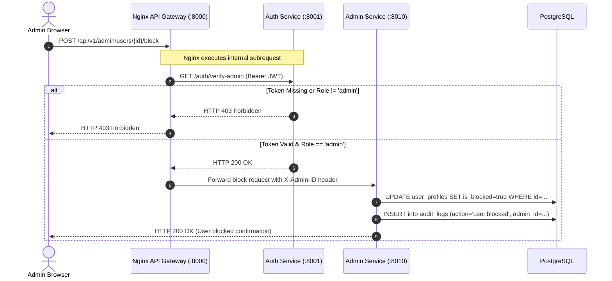

# Admin Service (`admin-service`)

## 1. Service Overview

The **Admin Service** provides administrative oversight, operations management, user governance, audit logging, and cross-service health probes for DevMeet administrators.

### Key Responsibilities
- **Cross-Service Health Probes**: Queries `/health` endpoints across all 13 backend services and infrastructure components (PostgreSQL, Redis, RabbitMQ) to construct a consolidated system health matrix.
- **User Governance**: Enables admins to inspect profiles, manually block/unblock malicious actors, change subscription plans, and permanently purge accounts.
- **Audit Log Exploration**: Exposes an immutable audit log trail (`audit_logs`) recording administrative actions, role modifications, and authentication anomalies.
- **Impersonation**: Generates time-bounded impersonation tokens allowing authorized support engineers to reproduce candidate issues in session state.

---

## 2. Admin Request Lifecycle & RBAC Verification



---

## 3. Modular Code Structure

```text
services/admin-service/
├── app/
│   ├── routes.py          # FastAPI endpoints (users, block, impersonate, health)
│   ├── database.py        # PostgreSQL admin queries and audit log readers
│   ├── models.py          # Pydantic administrative response schemas
│   ├── middleware.py      # Request tracing middleware
│   └── test_admin.py      # 18 unit tests verifying admin endpoints & security
├── Dockerfile
├── requirements.txt
└── README.md
```

---

## 4. API Endpoints

### `GET /api/v1/admin/stats`
- **Purpose**: System-wide platform metrics (total users, active sessions today, estimated MRR).

### `GET /api/v1/admin/users`
- **Purpose**: Paginated list of candidate profiles with status filters (blocked, plan type).

### `POST /api/v1/admin/users/{user_id}/block`
- **Purpose**: Flags account as blocked, immediately revoking active sessions.

### `GET /api/v1/admin/system/health`
- **Purpose**: Probes all 13 microservices and returns a unified JSON status dashboard.

---

## 5. Testing & Verification

```bash
# Run admin service unit tests
$env:PYTHONPATH="E:\AI INTERVIEW\services\admin-service"
python -m pytest services/admin-service/app/test_admin.py -v
```

---

## 6. Common Technical Interview Questions & Answers

### Q1: How does Nginx enforce RBAC before requests reach `admin-service`?
> **Answer**: Nginx uses the `ngx_http_auth_request_module` directive:
> ```nginx
> location /api/v1/admin {
>     auth_request /auth/verify-admin;
>     proxy_pass http://admin-service:8010;
> }
> location = /auth/verify-admin {
>     internal;
>     proxy_pass http://auth-service:8001/api/v1/auth/verify-admin;
> }
> ```
> This architecture ensures that unauthenticated or non-admin requests are stopped at the edge gateway before ever reaching the application container.
