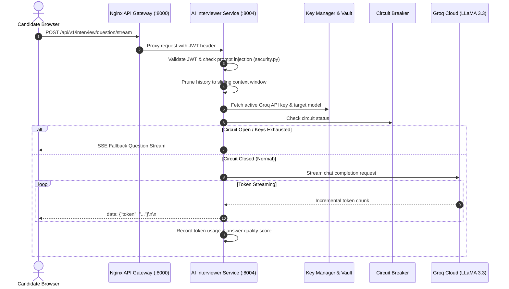

# AI Interviewer Service (`ai-interviewer-service`)

## 1. Service Overview

The **AI Interviewer Service** is the conversational core of DevMeet. It conducts dynamic, adaptive technical interviews by streaming tokens over Server-Sent Events (SSE) using Groq Cloud's ultra-fast LLaMA 3.3 70B and Mixtral models.

### Key Responsibilities
- **Real-Time Token Streaming**: Streams AI responses word-by-word via HTTP SSE (`/question/stream`) for ultra-low candidate latency.
- **Multi-Key Rotation Pool**: Distributes traffic across up to 5 Groq API keys with automated failover and HashiCorp Vault dynamic secret retrieval.
- **Circuit Breaker Protection**: Fails fast after 5 consecutive upstream timeouts, falling back to cached or deterministic question templates.
- **Prompt Injection Defense**: Sanitizes inputs and detects adversarial jailbreak patterns (`ignore previous instructions`, `reveal system prompt`), automatically terminating sessions with repeated violations.
- **Adaptive Difficulty Engine**: Dynamically calculates candidate response quality (0-10) using keyword and length heuristics, adjusting difficulty between Easy, Medium, and Hard.
- **STAR Framework Analysis**: Evaluates behavioral responses for Situation, Task, Action, and Result components.
- **3-Level DSA Hint System**: Delivers progressive hints (Level 1: General intuition; Level 2: Data structure suggestions; Level 3: Near-solution algorithmic guidance).

---

## 2. Request Lifecycle & Architecture



---

## 3. Modular Code Structure

```text
services/ai-interviewer-service/
├── app/
│   ├── circuit_breaker.py   # CircuitBreaker class & default instance
│   ├── cache.py             # ResponseCache for exact-match LLM deduplication
│   ├── key_manager.py       # Multi-key round-robin rotation & Vault integration
│   ├── security.py          # Prompt injection filters & context pruning
│   ├── prompts.py           # Domain prompts (DSA, System Design, Behavioral)
│   ├── heuristics.py        # STAR extractor & adaptive difficulty calculators
│   ├── ai_manager.py        # AIManager facade orchestrating Groq API calls
│   ├── routes.py            # FastAPI endpoints (SSE stream, hints, evaluation)
│   ├── models.py            # Pydantic schemas
│   ├── middleware.py        # RequestID tracing middleware
│   └── test_ai_interviewer.py # 44 unit tests with comprehensive mocks
├── Dockerfile
├── requirements.txt
└── README.md
```

---

## 4. API Endpoints

### `POST /api/v1/interview/question/stream`
- **Purpose**: Real-time SSE token streaming for live interview dialogue.
- **Auth**: Bearer JWT.
- **Body**:
  ```json
  {
    "interview_type": "dsa",
    "difficulty": "medium",
    "target_company": "Google",
    "conversation_history": [
      {"role": "assistant", "content": "Welcome! Let's solve Two Sum."},
      {"role": "user", "content": "I'll use a hash map for O(n) lookup."}
    ],
    "session_id": "sess-uuid-123"
  }
  ```
- **Response**: `text/event-stream` returning data packets:
  ```text
  data: {"token": "Great"}
  data: {"token": " approach."}
  data: [DONE]
  ```

### `POST /api/v1/interview/hint`
- **Purpose**: Generates progressive hint (level 1-3).
- **Body**: `{"question": "Two Sum", "hint_level": 2, "interview_type": "dsa"}`
- **Response**: `{"hint": "Use a hash map to store complements.", "hint_level": 2}`

### `POST /api/v1/interview/star-analysis`
- **Purpose**: Extracts behavioral STAR components from candidate answers.
- **Response**: `{"components": {"situation": true, "task": true, "action": true, "result": false}, "star_score": 75}`

---

## 5. Testing & Verification

```bash
# Run all 44 unit tests for ai-interviewer-service
$env:PYTHONPATH="E:\AI INTERVIEW\services\ai-interviewer-service"
python -m pytest services/ai-interviewer-service/app/test_ai_interviewer.py -v
```

---

## 6. Common Technical Interview Questions & Answers

### Q1: Why did you separate `ai_manager.py` into multiple modules?
> **Answer**: `ai_manager.py` originally exceeded 1,100 lines and violated Single Responsibility by mixing key management, circuit breaking, prompt templating, prompt injection regex filters, and Groq streaming. Decomposing it into `circuit_breaker.py`, `key_manager.py`, `security.py`, `prompts.py`, and `heuristics.py` provides high cohesion and allows independent unit testing of security rules and difficulty algorithms without mocking Groq network clients.

### Q2: How does the system handle Groq API rate limits (TPM / RPM)?
> **Answer**: We employ three layers of defense:
> 1. **Multi-key round-robin rotation** across up to 5 distinct Groq API keys loaded from HashiCorp Vault or environment variables.
> 2. **Ordered model fallback**: If `llama-3.3-70b-versatile` returns HTTP 429/503, the client rotates to `llama-3.1-8b-instant` or `mixtral-8x7b-32768`.
> 3. **Circuit Breaker**: If 5 consecutive failures occur within 60 seconds, the circuit opens for 30 seconds and returns pre-computed fallback templates, preventing request backlog.

### Q3: How do you prevent candidates from jailbreaking the AI interviewer?
> **Answer**: `security.py` runs compiled regex filters matching known jailbreaks (`ignore previous instructions`, `DAN mode`, `reveal system prompt`) against candidate turns before the prompt is formatted. Repeated violations are logged, and after 3 violations, the session is terminated.
