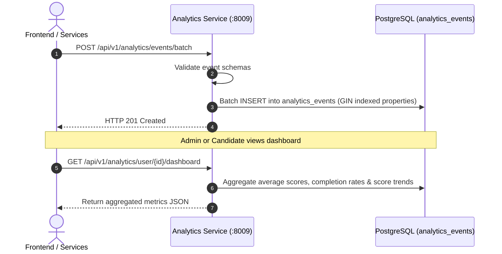

# Analytics Service (`analytics-service`)

## 1. Service Overview

The **Analytics Service** collects platform telemetry, computes candidate score distributions and performance trends, tracks conversion funnels, and exports metrics for administrative reporting.

### Key Responsibilities
- **Telemetry Ingestion**: Ingests individual events (`/event`) and bulk batches (`/events/batch`) with arbitrary metadata stored in PostgreSQL `analytics_events` indexed with GIN.
- **Score Distribution & Category Trends**: Calculates aggregate score percentiles, language usage distributions, and performance breakdown by difficulty.
- **Funnel & Retention Analytics**: Analyzes drop-off rates across the candidate onboarding funnel (Registration → Session Creation → Turn Completion → Report Generation).
- **Data Exporting**: Streams large analytical datasets as downloadable CSV spreadsheets (`/export/sessions.csv`, `/export/events.csv`).

---

## 2. Telemetry Ingestion & Aggregation Flow



---

## 3. Modular Code Structure

```text
services/analytics-service/
├── app/
│   ├── routes.py          # FastAPI endpoints (events, metrics, trends, exports)
│   ├── database.py        # PostgreSQL aggregation queries and CSV streaming
│   ├── models.py          # Pydantic analytical response models
│   ├── middleware.py      # Request tracing middleware
│   └── test_analytics.py   # 20 unit tests covering aggregation & exports
├── Dockerfile
├── requirements.txt
└── README.md
```

---

## 4. API Endpoints

### `POST /api/v1/analytics/event`
- **Purpose**: Records a single client or server telemetry event.

### `GET /api/v1/analytics/metrics`
- **Purpose**: Returns platform-wide KPI counters (total interviews, average score, active candidates).

### `GET /api/v1/analytics/user/{user_id}/dashboard`
- **Purpose**: Provides personalized candidate metrics: score progression over time, strengths/weaknesses by category, and completion velocity.

### `GET /api/v1/analytics/export/sessions.csv`
- **Purpose**: Streams historical session records as CSV for external business intelligence tools.

---

## 5. Testing & Verification

```bash
# Run analytics service unit tests
$env:PYTHONPATH="E:\AI INTERVIEW\services\analytics-service"
python -m pytest services/analytics-service/app/test_analytics.py -v
```

---

## 6. Common Technical Interview Questions & Answers

### Q1: Why use PostgreSQL with a GIN index on JSONB instead of a NoSQL database for telemetry events?
> **Answer**: PostgreSQL's `JSONB` data type combined with Generalized Inverted Indexes (GIN) allows high-throughput writes for unstructured event payloads (`properties`) while supporting fast query filtering (e.g. `WHERE properties @> '{"action": "tab_switch"}'`). By keeping analytics on PostgreSQL, the system avoids introducing another distributed database cluster (like MongoDB or Cassandra), keeping operations simple and within a single unified backup lifecycle.
