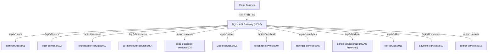

# API Gateway (`api-gateway`)

## 1. Service Overview

The **API Gateway** is the single entry point (Layer 7 reverse proxy) for all external client traffic entering DevMeet. Built on Nginx Alpine, it routes requests to downstream microservices, enforces rate-limiting policies, manages Cross-Origin Resource Sharing (CORS), and applies security headers.

### Key Responsibilities
- **Path Routing**: Maps public URL paths (`/api/v1/auth`, `/api/v1/interview`, `/api/v1/sessions`, etc.) to internal microservice Docker network endpoints.
- **Rate Limiting Zones**:
  - `auth_login`: 5 requests/min per IP (defends against brute-force password guessing).
  - `code_exec`: 10 requests/min per IP (protects Docker sandbox from exhaustion).
  - `ai_interview`: 20 requests/min per IP (protects Groq LLM token quotas).
  - `api_general`: 30 requests/sec per IP (general API traffic).
- **Dynamic CORS Reflection**: Reflects origin headers for local development and authorized production domains while preventing open wildcards with credentials.
- **Internal Auth Subrequests (`/auth/verify-admin`)**: Validates administrative credentials with `auth-service` before allowing requests to reach `admin-service`.

---

## 2. Gateway Architecture & Request Routing



---

## 3. Configuration & Routing Rules

```text
services/api-gateway/
├── nginx.conf          # Authoritative Nginx configuration file
├── Dockerfile          # Nginx Alpine container definition
└── README.md
```

### Rate Limiting Directives in `nginx.conf`:
```nginx
limit_req_zone $binary_remote_addr zone=api_general:10m rate=30r/s;
limit_req_zone $binary_remote_addr zone=auth_login:10m rate=5r/m;
limit_req_zone $binary_remote_addr zone=code_exec:10m rate=10r/m;
limit_req_zone $binary_remote_addr zone=ai_interview:10m rate=20r/m;
```

---

## 4. Common Technical Interview Questions & Answers

### Q1: Why use an API Gateway instead of letting the frontend call microservices directly?
> **Answer**: Direct client-to-microservice communication causes several problems:
> 1. It exposes all internal service ports and topologies to the public internet.
> 2. It requires complex CORS configurations on every service.
> 3. It forces clients to perform multiple round trips across different domain endpoints.
> An API Gateway provides a unified public interface, terminates TLS, enforces centralized rate limiting, and handles cross-cutting concerns (CORS, tracing headers, request logging) in a single location.

### Q2: How does the gateway handle Server-Sent Events (SSE) streaming?
> **Answer**: For the `/api/v1/interview/question/stream` route, Nginx must disable response buffering:
> ```nginx
> proxy_buffering off;
> proxy_cache off;
> proxy_set_header Connection '';
> chunked_transfer_encoding on;
> ```
> Without `proxy_buffering off;`, Nginx would buffer token chunks until the buffer is full rather than streaming tokens immediately to the candidate's browser.
