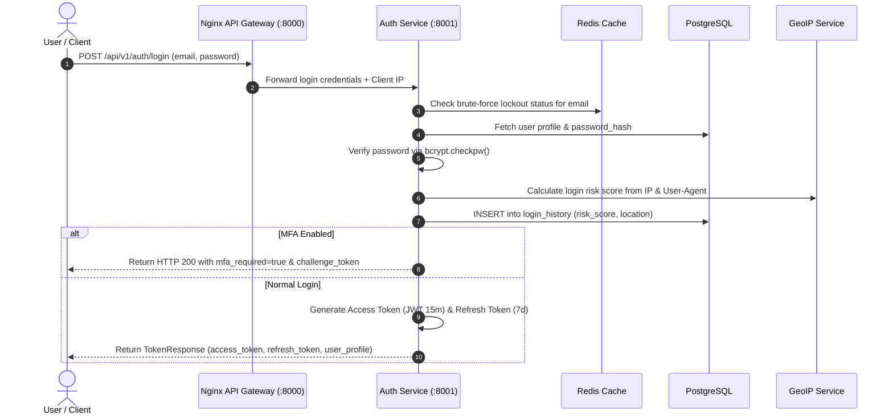

# Auth Service (`auth-service`)

## 1. Service Overview

The **Auth Service** is the identity provider and security gatekeeper for DevMeet. It handles user authentication, JWT lifecycle management, Role-Based Access Control (RBAC), multi-factor authentication (MFA/TOTP), GeoIP login risk evaluation, and brute-force protection.

### Key Responsibilities
- **JWT Lifecycle Management**: Issues cryptographically signed HS256 access tokens (short-lived, 15m) and refresh tokens (long-lived, 7d).
- **Password Security**: Uses `bcrypt` with salt rounds for one-way password hashing.
- **Role-Based Access Control (RBAC)**: Distinguishes between regular `user` and `admin` roles, providing internal verification subrequests for Nginx API Gateway (`/verify-admin`).
- **Two-Factor Authentication (MFA / TOTP)**: Generates TOTP secrets and backup recovery codes.
- **GeoIP Risk Scoring (`geoip_service.py`)**: Inspects incoming client IP addresses, resolves geographic coordinates, and flags anomalous logins.
- **Brute-Force & Token Blacklisting**: Uses Redis to track failed login attempts, locking accounts after 5 consecutive failures for 30 minutes, and blacklisting revoked JWT tokens on logout.

---

## 2. Authentication Lifecycle & Token Flow



---

## 3. Modular Code Structure

```text
services/auth-service/
├── app/
│   ├── auth.py              # AuthManager (JWT encoding, decoding, bcrypt hashing)
│   ├── geoip_service.py     # GeoIP location resolution & login risk analysis
│   ├── routes.py            # FastAPI endpoints (register, login, refresh, MFA)
│   ├── database.py          # PostgreSQL user_profiles, login_history queries
│   ├── models.py            # Pydantic validation schemas
│   ├── middleware.py        # Correlation ID tracing middleware
│   └── test_auth.py         # 23 unit tests verifying authentication flows
├── Dockerfile
├── requirements.txt
└── README.md
```

---

## 4. API Endpoints

### `POST /api/v1/auth/register`
- **Purpose**: Creates a new candidate account.
- **Validations**: Valid email format, strong password (min 8 chars, uppercase, digit, special char).

### `POST /api/v1/auth/login`
- **Purpose**: Authenticates candidate and issues JWT token pair.

### `POST /api/v1/auth/refresh`
- **Purpose**: Exchanges a valid refresh token for a new access token without re-prompting for credentials.

### `POST /api/v1/auth/logout`
- **Purpose**: Revokes access token by adding its `jti` to Redis blacklist until expiration.

### `GET /api/v1/auth/verify-admin`
- **Purpose**: Internal Nginx subrequest verifying that the incoming JWT possesses the `admin` role before allowing access to `/api/v1/admin/*`.

---

## 5. Testing & Verification

```bash
# Run auth service tests
$env:PYTHONPATH="E:\AI INTERVIEW\services\auth-service"
python -m pytest services/auth-service/app/test_auth.py -v
```

---

## 6. Common Technical Interview Questions & Answers

### Q1: How does DevMeet differentiate Authentication from Authorization?
> **Answer**: Authentication verifies *who* the user is (validating email and password or OAuth credentials and issuing a signed JWT). Authorization determines *what* the authenticated user is allowed to do (inspecting the `role` claim in the decoded JWT, e.g. enforcing that only `admin` users can access `/api/v1/admin/*` or delete other users).

### Q2: Why use both an Access Token and a Refresh Token instead of a single long-lived token?
> **Answer**: If an access token is compromised, a short expiration window (15 minutes) limits the attacker's window of opportunity. The refresh token (7 days) is stored securely (httpOnly cookie or client keystore) and is only transmitted to the `/refresh` endpoint, drastically reducing its exposure across standard API calls. Furthermore, refresh tokens can be revoked immediately in Redis if a user clicks "Logout from all devices".
