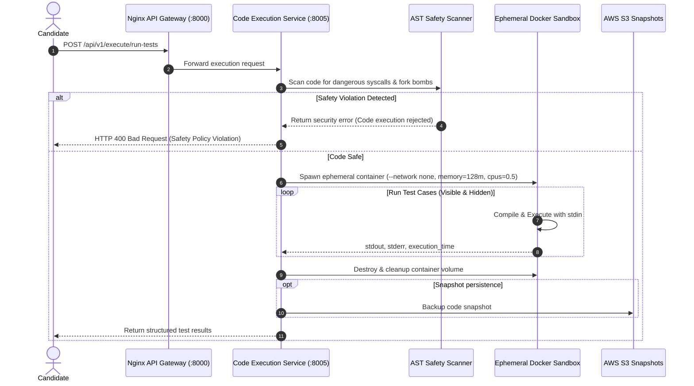

# Code Execution Service (`code-execution-service`)

## 1. Service Overview

The **Code Execution Service** provides secure, sandboxed compilation and execution of candidate code submissions across 6 programming languages: Python, JavaScript, Java, C++, Go, and Rust.

### Key Responsibilities
- **Containerized Sandboxing**: Spawns isolated Docker containers with strict security constraints:
  - Disables networking (`--network none`).
  - Imposes memory quotas (`128m`) and CPU caps (`0.5` vCPU).
  - Enforces process execution timeouts (default 10s, max 60s).
  - Mounts code via ephemeral, disposable temporary volumes.
- **Multi-Language Test Runner (`submission_runner.py`)**: Runs code against visible and hidden test cases, validating stdin/stdout matching and runtime performance.
- **AST & Heuristic Safety Scanning**: Scans code prior to container creation for malicious system calls (`os.system`, `subprocess`, `fork()`, network socket creation, file system wipes).
- **Asynchronous Task Queue**: Supports non-blocking job submissions via RabbitMQ task queues, publishing execution results to Redis.

---

## 2. Request Lifecycle & Sandboxing Architecture



---

## 3. Modular Code Structure

```text
services/code-execution-service/
├── app/
│   ├── executor.py            # CodeExecutor class managing Docker SDK & fallback runner
│   ├── submission_runner.py   # TestRunner, TestCase & TestResult classes
│   ├── queue_manager.py       # RabbitMQ worker consumer & task producer
│   ├── s3_service.py          # AWS S3 code snapshot storage
│   ├── routes.py              # FastAPI endpoints (execute, run-tests, safety)
│   ├── models.py              # Pydantic schemas
│   ├── middleware.py          # Request tracing middleware
│   └── test_code_execution.py # 28 unit tests covering safety scans & runner
├── Dockerfile
├── requirements.txt
└── README.md
```

---

## 4. Supported Languages & Container Images

| Language | Execution Engine | Sandbox Command | Default Timeout |
|---|---|---|:---:|
| **Python** | `python:3.11-slim` | `python3 solution.py` | 10s |
| **JavaScript** | `node:20-slim` | `node solution.js` | 10s |
| **Java** | `openjdk:17-slim` | `javac Solution.java && java Solution` | 15s |
| **C++** | `gcc:latest` | `g++ -O2 solution.cpp -o solution && ./solution` | 15s |
| **Go** | `golang:1.21-alpine` | `go run solution.go` | 15s |
| **Rust** | `rust:1.75-slim` | `rustc solution.rs -o solution && ./solution` | 20s |

---

## 5. Testing & Verification

```bash
# Run all 28 unit tests
$env:PYTHONPATH="E:\AI INTERVIEW\services\code-execution-service"
python -m pytest services/code-execution-service/app/test_code_execution.py -v
```

---

## 6. Common Technical Interview Questions & Answers

### Q1: How do you prevent malicious candidates from executing fork bombs or hacking the server?
> **Answer**: We enforce defense-in-depth:
> 1. Static pre-execution analysis: We scan source code with AST and regular expressions for dangerous modules (`subprocess`, `ctypes`, `socket`, `fork`, `shutil`).
> 2. Ephemeral Docker isolation: Code runs in a disposable container with `--network none` (no internet or local LAN access), memory hard-capped at 128 MB, CPU quota limited to 0.5 vCPU, and a non-root user.
> 3. Execution time limits: Subprocesses are terminated with SIGKILL if execution exceeds the timeout threshold.

### Q2: Why did you rename `test_runner.py` to `submission_runner.py`?
> **Answer**: In Python test discovery, standard test runners like pytest automatically match any file beginning with `test_*.py` as a pytest test suite. `test_runner.py` was actually a domain module for running candidate test cases inside Docker. Pytest mistakenly attempted to import it as a unit test file and threw import errors. Renaming it to `submission_runner.py` eliminated namespace collisions and made the file's responsibility unambiguous.
