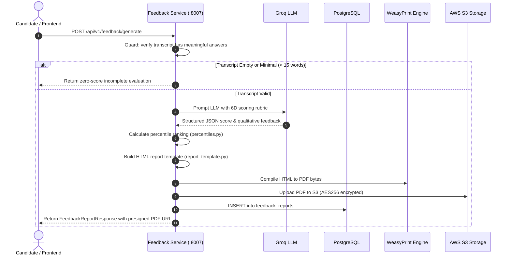

# Feedback Service (`feedback-service`)

## 1. Service Overview

The **Feedback Service** evaluates candidate performance across technical and behavioral interview sessions, produces 6-dimensional scorecards, benchmarks candidate percentiles against peer cohorts, and generates styled PDF evaluation reports stored in AWS S3.

### Key Responsibilities
- **6-Dimensional Evaluation Matrix**:
  1. *Problem Solving Score* (0-100)
  2. *Code Quality Score* (0-100)
  3. *System Architecture Score* (0-100)
  4. *Behavioral / STAR Alignment Score* (0-100)
  5. *Communication Score* (0-100)
  6. *Time & Space Complexity Score* (0-100)
- **Cohort Percentile Benchmarking (`percentiles.py`)**: Ranks candidate performance relative to simulated and historical cohorts based on interview type and difficulty.
- **HTML Report Templating (`report_template.py`)**: Builds responsive, print-optimized HTML scorecards with CSS paged media rules (`@page`).
- **PDF Compilation & Storage (`generator.py`)**: Converts HTML reports into PDF documents using WeasyPrint and uploads them to AWS S3 with 7-day presigned download URLs.

---

## 2. Request Lifecycle & Generation Architecture



---

## 3. Modular Code Structure

```text
services/feedback-service/
├── app/
│   ├── percentiles.py         # Cohort percentile calculation tables
│   ├── report_template.py     # HTML/CSS template builder for evaluation report
│   ├── generator.py           # FeedbackGenerator coordinating LLM, PDF, and S3
│   ├── database.py            # PostgreSQL feedback_reports queries
│   ├── routes.py              # FastAPI endpoints (generate, get, pdf)
│   ├── models.py              # Pydantic schemas
│   ├── middleware.py          # Request tracing middleware
│   └── test_feedback.py      # 12 unit tests verifying generation & fallback
├── Dockerfile
├── requirements.txt
└── README.md
```

---

## 4. API Endpoints

### `POST /api/v1/feedback/generate`
- **Purpose**: Generates full evaluation report from an interview transcript.
- **Request Body**:
  ```json
  {
    "session_id": "sess-uuid-123",
    "interview_type": "dsa",
    "difficulty": "medium",
    "language": "python",
    "target_company": "Google",
    "transcript": [
      {"role": "interviewer", "content": "How would you solve Two Sum?"},
      {"role": "candidate", "content": "I would use a hash map to store complements in O(n) time."}
    ]
  }
  ```
- **Response**: Full scorecard JSON with `overall_score`, 6D scores, strengths, weaknesses, and presigned `pdf_url`.

### `GET /api/v1/feedback/{session_id}`
- **Purpose**: Retrieves previously generated feedback report from PostgreSQL.

### `GET /api/v1/feedback/{session_id}/pdf`
- **Purpose**: Directly streams the evaluation PDF bytes as `application/pdf`.

---

## 5. Testing & Verification

```bash
# Run feedback service unit tests
$env:PYTHONPATH="E:\AI INTERVIEW\services\feedback-service"
python -m pytest services/feedback-service/app/test_feedback.py -v
```

---

## 6. Common Technical Interview Questions & Answers

### Q1: Why did you separate HTML templating from PDF generation?
> **Answer**: `generator.py` originally contained over 700 lines with hardcoded HTML tables, CSS stylesheets, and percentile lookup dictionaries embedded directly inside business logic methods. By separating the styling into `report_template.py` and benchmark calculations into `percentiles.py`, the core `FeedbackGenerator` class remains focused solely on orchestrating LLM calls, WeasyPrint compilation, and S3 uploads.

### Q2: How does the system handle WeasyPrint dependencies on systems without GTK/Pango libraries?
> **Answer**: WeasyPrint requires native C libraries (`libpango`, `libcairo`). In `generator.py`, we gracefully handle `ImportError: cannot import name HTML from weasyprint` so that the service can continue operating in local development environments without crashing, while compiling PDFs inside the Linux Docker container where GTK libraries are pre-installed.
