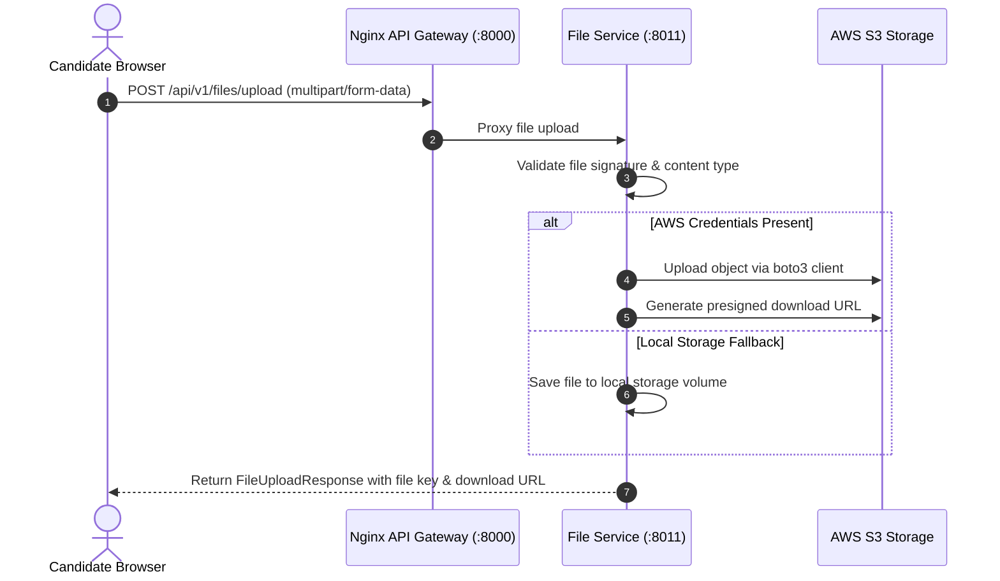

# File Service (`file-service`)

## 1. Service Overview

The **File Service** manages binary asset storage for DevMeet, supporting avatar images, candidate resumes, and interview artifacts. It integrates with AWS S3 with transparent fallback to local disk storage for offline environments.

### Key Responsibilities
- **AWS S3 Integration**: Uploads objects to S3 buckets using `boto3` with server-side encryption.
- **Presigned URLs**: Issues time-limited presigned GET and PUT URLs so client browsers can stream files directly to and from AWS S3 without overloading backend API bandwidth.
- **Local Filesystem Fallback**: Automatically stores files on disk when AWS credentials are absent.
- **Content Type & Size Enforcement**: Rejects unauthorized file extensions and enforces size limits.

---

## 2. File Upload Architecture



---

## 3. Modular Code Structure

```text
services/file-service/
├── app/
│   ├── storage.py           # StorageBackend abstraction (S3 and LocalDisk)
│   ├── routes.py            # FastAPI endpoints (upload, download, presign, delete)
│   ├── middleware.py        # Request tracing middleware
│   └── test_file.py         # 14 unit tests verifying uploads & presigning
├── Dockerfile
├── requirements.txt
└── README.md
```

---

## 4. API Endpoints

### `POST /api/v1/files/upload`
- **Purpose**: Uploads multipart file (avatar or resume).

### `GET /api/v1/files/presign/{key}`
- **Purpose**: Returns a secure, presigned S3 URL valid for a designated expiry window (default 1 hour).

### `GET /api/v1/files/download/{key}`
- **Purpose**: Streams file content directly through the service.

---

## 5. Testing & Verification

```bash
# Run file service unit tests
$env:PYTHONPATH="E:\AI INTERVIEW\services\file-service"
python -m pytest services/file-service/app/test_file.py -v
```

---

## 6. Common Technical Interview Questions & Answers

### Q1: Why use S3 Presigned URLs instead of proxying file bytes through backend servers?
> **Answer**: Proxying large file streams (e.g. video files, multi-megabyte resumes) through backend FastAPI application servers consumes valuable CPU cycles, network sockets, and worker threads. Presigned URLs allow clients to transfer data directly with AWS S3's globally distributed storage infrastructure, offloading all bandwidth from the backend.
