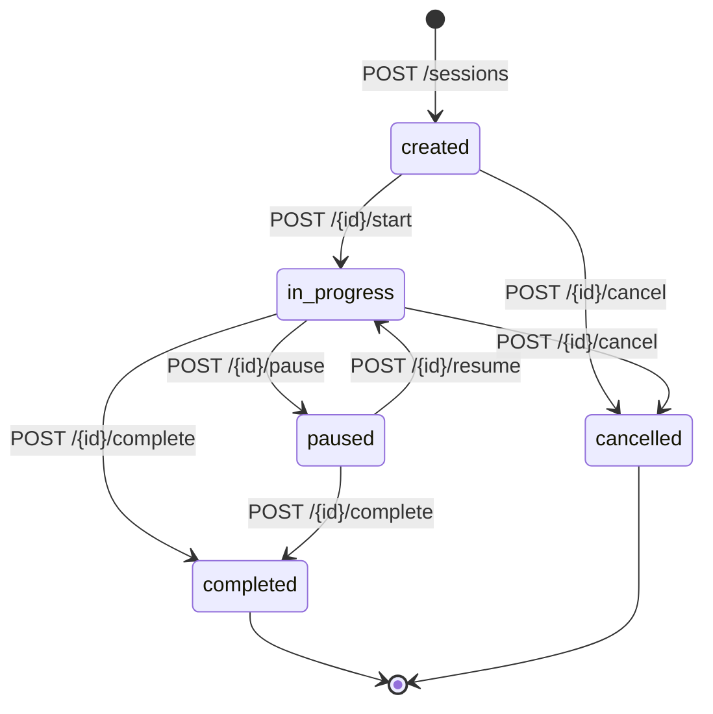
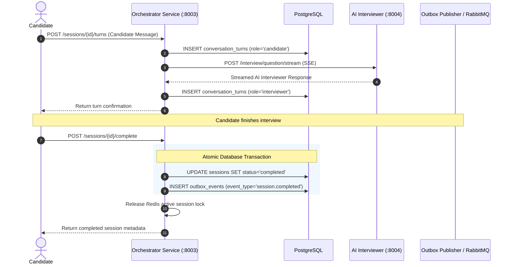

# Orchestrator Service (`orchestrator-service`)

## 1. Service Overview

The **Orchestrator Service** is the central state machine and workflow coordinator of DevMeet. It governs the entire interview session lifecycle from creation, turn management, and anti-cheat monitoring to session completion and outbox event dispatch.

### Key Responsibilities
- **Interview State Machine**: Manages transitions between `created`, `in_progress`, `paused`, `completed`, and `cancelled` with strict state validation.
- **Concurrent Session Guard**: Enforces that a user can only have at most one active interview session at any time using distributed Redis locks.
- **Transactional Outbox Pattern**: When a session completes, the status change and an outbox event (`session.completed`) are written to PostgreSQL inside the same atomic database transaction, preventing dual-write inconsistency.
- **Turn Orchestration**: Manages sequential interview dialogue turns in `conversation_turns`.
- **Proctoring Telemetry**: Tracks candidate tab switching, copy-pasting, and camera gaze telemetry.
- **Disaster Recovery Snapshots**: Exports and restores session state to AWS S3.

---

## 2. Session Lifecycle & State Machine



### Turn Processing Sequence Diagram



---

## 3. Modular Code Structure

```text
services/orchestrator-service/
├── app/
│   ├── clients.py           # HTTP clients for Auth, User, and Search services
│   ├── routes.py            # Cleaned FastAPI route controllers
│   ├── database.py          # PostgreSQL session, turn, and code operations
│   ├── redis_client.py      # Redis distributed locks and session caching
│   ├── outbox.py            # Transactional outbox event emitter
│   ├── idempotency.py       # Request deduplication with 24-hr expiry
│   ├── s3_service.py        # S3 snapshot backup and disaster recovery
│   ├── models.py            # Pydantic schemas & state machine validators
│   ├── middleware.py        # Correlation ID tracing middleware
│   └── test_orchestrator.py # 9 unit tests verifying session state transitions
├── Dockerfile
├── requirements.txt
└── README.md
```

---

## 4. API Endpoints

### `POST /api/v1/sessions`
- **Purpose**: Creates a new interview session.
- **Workflow**:
  1. Validates JWT with `auth-service`.
  2. Concurrently checks quota with `user-service` and checks for active sessions in Redis.
  3. Fetches domain seed question from `search-service`.
  4. Inserts session into `sessions` table in `created` status.
  5. Acquires active session key in Redis: `user:{user_id}:active_session`.

### `POST /api/v1/sessions/{id}/turns`
- **Purpose**: Submits candidate turn and persists both candidate input and AI interviewer response.

### `POST /api/v1/sessions/{id}/complete`
- **Purpose**: Completes interview session atomically, writing a `session.completed` outbox record.

### `POST /api/v1/sessions/{id}/cheating`
- **Purpose**: Increments cheating telemetry counters (tab switch count, paste count) for proctoring audits.

---

## 5. Testing & Verification

```bash
# Run orchestrator service tests
$env:PYTHONPATH="E:\AI INTERVIEW\services\orchestrator-service"
python -m pytest services/orchestrator-service/app/test_orchestrator.py -v
```

---

## 6. Common Technical Interview Questions & Answers

### Q1: What is the Transactional Outbox Pattern and why do you use it here?
> **Answer**: In a microservices architecture, updating a database and publishing an event to a message queue (RabbitMQ) is a dual-write problem. If the database update succeeds but the message broker crashes before the message is published, the event is lost. By inserting the event into the `outbox_events` table inside the *exact same PostgreSQL database transaction* as the session status update, atomicity is guaranteed by the ACID database. A background relay worker then reads unpublished outbox events and reliably publishes them to RabbitMQ.

### Q2: How do you prevent a user from opening two simultaneous interview tabs?
> **Answer**: We use a two-tiered check:
> 1. Fast path: Redis distributed key `user:{user_id}:active_session` is checked first.
> 2. Authoritative path: If not in cache, PostgreSQL is queried for any session in `created` or `in_progress` status for that `user_id`. If found, the endpoint rejects the request with HTTP 409 Conflict.
