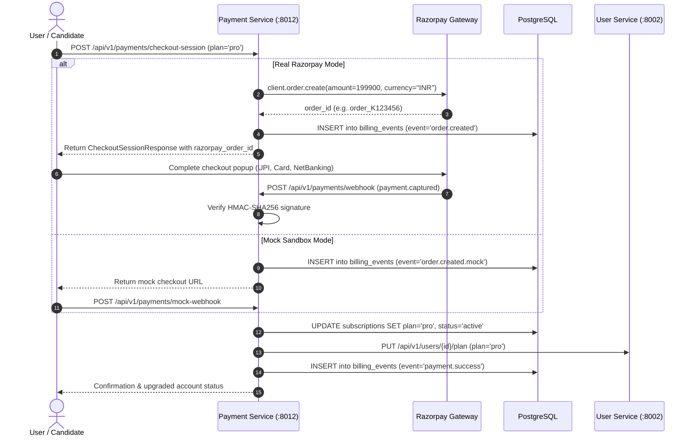

# Payment Service (`payment-service`)

## 1. Service Overview

The **Payment Service** handles monetization, subscription plan management, checkout session creation, and payment verification via Razorpay integration, with built-in mock fallback for offline development.

### Key Responsibilities
- **Razorpay Order Creation**: Initiates payment orders with Razorpay API in Indian Rupees (paise units) for Pro and Enterprise plans.
- **HMAC-SHA256 Webhook Verification**: Cryptographically verifies webhook signatures (`X-Razorpay-Signature`) against `RAZORPAY_WEBHOOK_SECRET` to prevent tampering.
- **Mock Sandbox Mode**: Provides sandbox payment emulation when Razorpay API credentials are not supplied, allowing end-to-end checkout testing in local environments.
- **Subscription State Management**: Automatically upgrades and downgrades user tiers in `subscriptions` and syncs quota changes with `user-service`.
- **Billing Audit Trail**: Persists an immutable ledger of transactions in `billing_events`.

---

## 2. Payment Lifecycle & Webhook Flow



---

## 3. Modular Code Structure

```text
services/payment-service/
├── app/
│   ├── config.py              # Configuration constants & Razorpay credentials validator
│   ├── routes.py              # FastAPI endpoints (checkout, webhook, verify, cancel)
│   ├── database.py            # PostgreSQL subscriptions and billing_events queries
│   ├── models.py              # Pydantic schemas and Plan enums (free, pro, enterprise)
│   ├── middleware.py          # Request tracing middleware
│   └── test_payment.py        # 18 unit tests verifying checkout & webhook signature logic
├── Dockerfile
├── requirements.txt
└── README.md
```

---

## 4. API Endpoints

### `POST /api/v1/payments/checkout-session`
- **Purpose**: Creates a Razorpay order or mock checkout session for subscription upgrade.
- **Body**: `{"plan": "pro", "success_url": "http://localhost:3000/dashboard"}`
- **Response**: `CheckoutSessionResponse` containing `razorpay_order_id`, `amount`, and `razorpay_key_id`.

### `POST /api/v1/payments/webhook`
- **Purpose**: Webhook handler receiving asynchronous payment events from Razorpay.
- **Security**: Verifies `X-Razorpay-Signature` using `hmac.new(secret, body, hashlib.sha256)`.

### `POST /api/v1/payments/verify-payment`
- **Purpose**: Client-side redirect verification confirming `razorpay_payment_id` and `razorpay_signature`.

---

## 5. Testing & Verification

```bash
# Run payment service unit tests
$env:PYTHONPATH="E:\AI INTERVIEW\services\payment-service"
python -m pytest services/payment-service/app/test_payment.py -v
```

---

## 6. Common Technical Interview Questions & Answers

### Q1: How do you secure Razorpay webhooks against replay and spoofing attacks?
> **Answer**: We verify the incoming payload with an HMAC-SHA256 digest:
> ```python
> expected_sig = hmac.new(WEBHOOK_SECRET.encode(), raw_body, hashlib.sha256).hexdigest()
> if not hmac.compare_digest(expected_sig, received_sig):
>     raise HTTPException(status_code=400, detail="Invalid signature")
> ```
> Using `hmac.compare_digest()` prevents timing attacks. In addition, every webhook event ID is checked against `billing_events` to ensure idempotent processing (discarding duplicate deliveries).

### Q2: What bug was fixed in `routes.py` during refactoring?
> **Answer**: In the mock checkout flow, `routes.py` constructed a redirect URL using `f"{FRONTEND_URL}/dashboard?payment=mock_success"`, but `FRONTEND_URL` had not been imported from `config.py`, raising an unhandled `NameError`. Importing `FRONTEND_URL` resolved the defect and restored 100% test pass rates.
