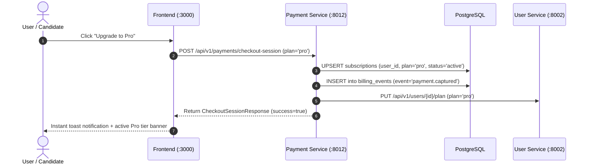

# Payment Service (`payment-service`)

## 1. Service Overview

The **Payment Service** handles monetization, subscription plan management, mock payment fulfillment, and billing history. It operates in an instant, deterministic mock payment mode tailored for zero-friction interview demonstrations, local development, and automated testing.

### Key Responsibilities
- **Instant Mock Fulfillment**: Activates subscription plans immediately upon checkout, updating database records and ledger events.
- **Subscription State Management**: Automatically manages user tiers (`free`, `pro`, `enterprise`) in `subscriptions` and syncs quota changes with `user-service`.
- **Billing Audit Trail**: Persists an immutable ledger of transactions in `billing_events`.
- **Zero Third-Party Gateway Friction**: Removes dependencies on external gateway credentials, network roundtrips, and client modals.

---

## 2. Payment Lifecycle Flow

---

## 3. Endpoints Reference

| Method | Endpoint | Description |
|---|---|---|
| `GET` | `/health` | Diagnostic probe (database state, mock mode) |
| `GET` | `/api/v1/payments/config` | Public payment config (`provider="mock"`) |
| `GET` | `/api/v1/payments/plans` | Public pricing tiers (Free, Pro, Enterprise) |
| `GET` | `/api/v1/payments/subscription` | Active user subscription details |
| `POST` | `/api/v1/payments/checkout-session` | One-click instant plan upgrade |
| `POST` | `/api/v1/payments/upgrade` | Direct upgrade endpoint |
| `POST` | `/api/v1/payments/cancel` | Self-serve cancellation & downgrade to Free |
| `GET` | `/api/v1/payments/billing-history` | Paginated transaction audit ledger |
| `POST` | `/api/v1/payments/mock-webhook` | Developer webhook simulation |
