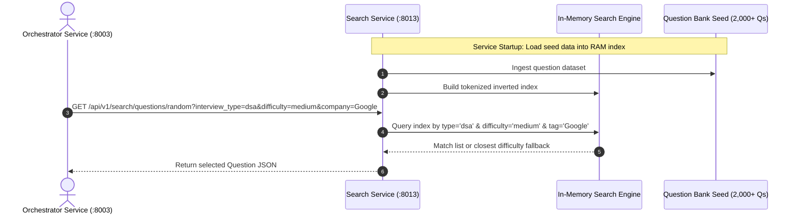

# Search Service (`search-service`)

## 1. Service Overview

The **Search Service** indexes and provides fast in-memory search over DevMeet's question catalog of 2,000+ curated interview problems spanning Data Structures & Algorithms, System Design architectures, and Behavioral leadership scenarios.

### Key Responsibilities
- **In-Memory Question Bank Index (`search_engine.py`)**: Tokenizes problem descriptions, focus areas, and company tags for sub-millisecond retrieval.
- **Multi-Facet Filtering**: Filters questions by interview domain (`dsa`, `system_design`, `behavioral`), difficulty (`easy`, `medium`, `hard`), and target company (Google, Amazon, Meta, Microsoft, Netflix, Apple).
- **Random Question Selector**: Provides random seed questions for `orchestrator-service` during interview initialization.

---

## 2. Question Search Architecture



---

## 3. Modular Code Structure

```text
services/search-service/
├── app/
│   ├── search_engine.py    # SearchEngine with token index, fuzzy match & ranker
│   ├── questions_seed.py   # Curated seed database of interview problems
│   ├── routes.py           # FastAPI endpoints (search, random, get by ID)
│   ├── models.py           # Pydantic schemas (Question, SearchResponse)
│   ├── middleware.py       # Request tracing middleware
│   └── test_search.py      # 20 unit tests verifying search precision & randomizer
├── Dockerfile
├── requirements.txt
└── README.md
```

---

## 4. API Endpoints

### `GET /api/v1/search/questions`
- **Purpose**: Full-text keyword and facet search across questions.
- **Query Params**: `q` (text search), `interview_type`, `difficulty`, `company`, `page`, `page_size`.

### `GET /api/v1/search/questions/random`
- **Purpose**: Returns a randomized question matching the requested interview criteria. Used by `orchestrator-service`.

---

## 5. Testing & Verification

```bash
# Run search service unit tests
$env:PYTHONPATH="E:\AI INTERVIEW\services\search-service"
python -m pytest services/search-service/app/test_search.py -v
```

---

## 6. Common Technical Interview Questions & Answers

### Q1: Why use an in-memory inverted index instead of Elasticsearch for question search?
> **Answer**: The curated question bank contains approximately 2,000 to 5,000 technical interview questions. At this scale, the entire corpus fits comfortably in ~15 MB of RAM. An in-memory inverted index provides sub-millisecond query responses (< 2ms) without the memory overhead (1-2 GB JVM heap) and cluster management complexity of running an Elasticsearch or OpenSearch cluster.
