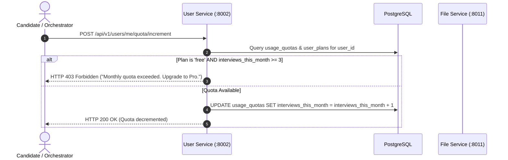

# User Service (`user-service`)

## 1. Service Overview

The **User Service** manages candidate identities, profiles, quota enforcement, subscription plan mappings, avatar uploads, global leaderboards, and GDPR data compliance.

### Key Responsibilities
- **Profile Management**: Stores candidate display names, bios, target companies, and skill tags.
- **Quota Enforcement**: Tracks monthly and daily interview usage in `usage_quotas`. Enforces free-tier limits (3 interviews/month) while granting unlimited access to Pro and Enterprise subscribers.
- **GDPR Compliance**: Provides complete data portability via `GET /me/export` (exporting profile, sessions, turns, and billing records in JSON) and permanent account erasure via `DELETE /me`.
- **Leaderboard Calculation**: Computes top candidate rankings based on aggregate interview scores.
- **Pydantic v2 Modernization**: Upgraded schema validators to modern `@field_validator` classmethods.

---

## 2. Request Lifecycle & Quota Flow



---

## 3. Modular Code Structure

```text
services/user-service/
├── app/
│   ├── routes.py          # FastAPI endpoints (profile, quota, avatar, GDPR)
│   ├── database.py        # PostgreSQL queries for user_profiles and usage_quotas
│   ├── models.py          # Pydantic models with Pydantic v2 @field_validator
│   ├── middleware.py      # Request tracing middleware
│   └── test_user.py       # 14 unit tests verifying profile, quota & GDPR flows
├── Dockerfile
├── requirements.txt
└── README.md
```

---

## 4. API Endpoints

### `GET /api/v1/users/me`
- **Purpose**: Returns the current candidate's profile, target companies, and skill tags.

### `PUT /api/v1/users/me`
- **Purpose**: Updates profile information. Sanitizes input to reject HTML tags.

### `GET /api/v1/users/me/quota`
- **Purpose**: Returns quota metrics (interviews used, remaining, and renewal date).

### `POST /api/v1/users/me/quota/increment`
- **Purpose**: Called by `orchestrator-service` during interview creation to consume a quota credit.

### `GET /api/v1/users/me/export`
- **Purpose**: GDPR data export returning all user records across all services in structured JSON format.

### `DELETE /api/v1/users/me`
- **Purpose**: GDPR "Right to be Forgotten" endpoint performing cascading account deletion.

---

## 5. Testing & Verification

```bash
# Run user service unit tests
$env:PYTHONPATH="E:\AI INTERVIEW\services\user-service"
python -m pytest services/user-service/app/test_user.py -v
```

---

## 6. Common Technical Interview Questions & Answers

### Q1: How does the quota system handle timezone shifts and monthly resets?
> **Answer**: Quotas are tracked in `usage_quotas` with a `last_reset_date` column. When a quota check occurs, the service compares `last_reset_date` against `CURRENT_DATE`. If the current month or date has advanced beyond the recorded date, counters (`interviews_today`, `interviews_this_month`) are reset to 0 in PostgreSQL before evaluating limits.

### Q2: How is GDPR compliance implemented?
> **Answer**: We address two core GDPR mandates:
> 1. *Right to Access / Data Portability (Article 20)*: `GET /me/export` gathers user profile attributes, conversation transcripts, code submissions, feedback reports, and payment logs into a consolidated JSON document.
> 2. *Right to Erasure (Article 17)*: `DELETE /me` executes cascading deletes across `user_profiles`, purging personal records while anonymizing security audit logs.
