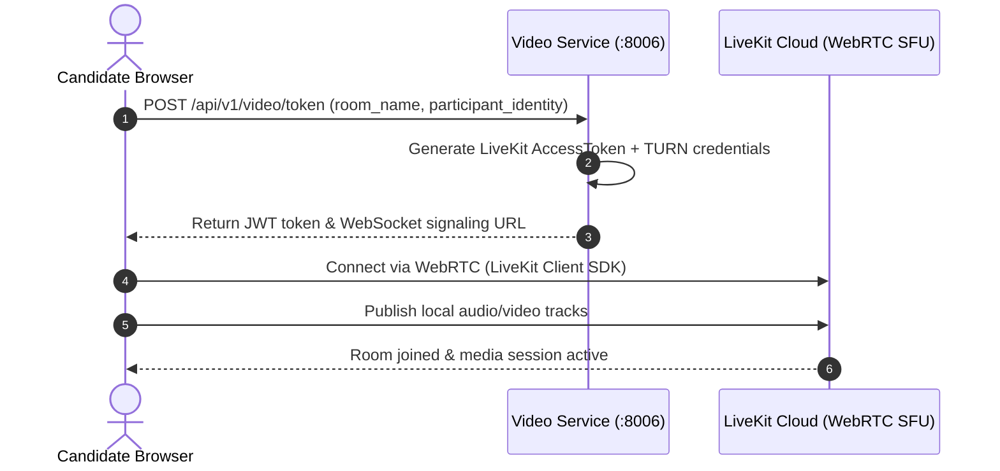

# Video Service (`video-service`)

## 1. Service Overview

The **Video Service** coordinates WebRTC video and audio sessions for live mock interviews. It integrates with LiveKit Cloud to issue cryptographic access tokens and manage room lifecycles.

### Key Responsibilities
- **LiveKit Access Token Generation (`tokenService.js`)**: Signs JWT tokens with room join, audio/video publish, and subscription grants.
- **NAT Traversal & TURN Server Integration**: Distributes TURN credentials for candidates behind strict symmetric firewalls.
- **Room Lifecycle & Auto-Pruning (`roomManager.js`)**: Tracks active participant counts and automatically purges inactive rooms after 30 minutes of idle time.
- **Preflight Device Diagnostics**: Validates candidate camera, microphone, and WebRTC network connectivity before starting an interview.

---

## 2. WebRTC Connection Lifecycle



---

## 3. Modular Code Structure

```text
services/video-service/
├── src/
│   ├── tokenService.js     # LiveKit AccessToken creation & TURN configuration
│   ├── roomManager.js      # Inactivity auto-pruning, room state & quality metrics
│   └── index.js            # Express server & API route declarations
├── Dockerfile
├── package.json
└── README.md
```

---

## 4. API Endpoints

### `POST /api/v1/video/token`
- **Purpose**: Issues a signed LiveKit token with grants to join the specified room.
- **Body**: `{"room_name": "room-sess-123", "participant_identity": "candidate-1"}`

### `POST /api/v1/video/room/create`
- **Purpose**: Explicitly reserves a room associated with an interview session.

### `DELETE /api/v1/video/room/:room_name`
- **Purpose**: Closes the room and evicts connected participants upon interview completion.

---

## 5. Common Technical Interview Questions & Answers

### Q1: What is an SFU (Selective Forwarding Unit) and why use LiveKit instead of peer-to-peer mesh?
> **Answer**: In a peer-to-peer mesh, each participant must upload their video stream to every other participant, scaling as $O(N^2)$ network bandwidth. An SFU like LiveKit acts as an intelligent media router: each participant uploads their stream once to the SFU, which routes and forwards media packets to receivers. This minimizes client bandwidth and CPU usage.

### Q2: What happens if LiveKit credentials are not configured?
> **Answer**: `tokenService.js` detects the absence of `LIVEKIT_API_KEY` and automatically falls back to Mock Token Mode, returning mock JWT tokens so that frontend UI flows and automated testing can function without external cloud dependencies.
